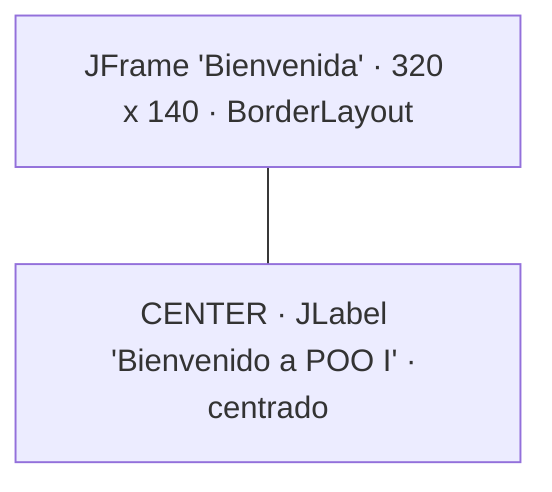
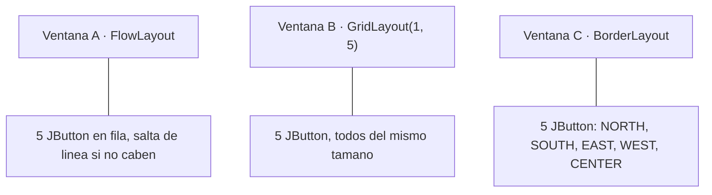
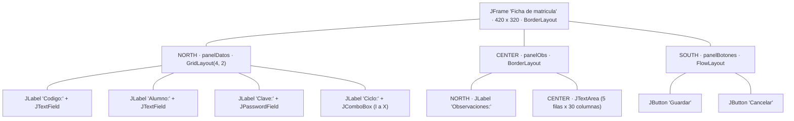
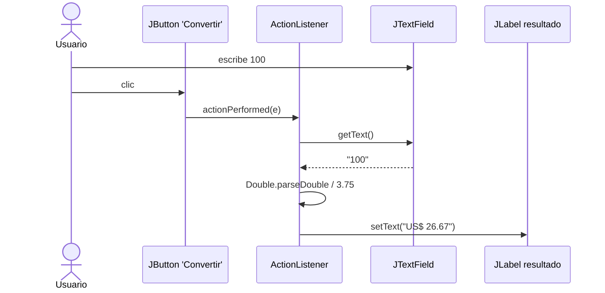
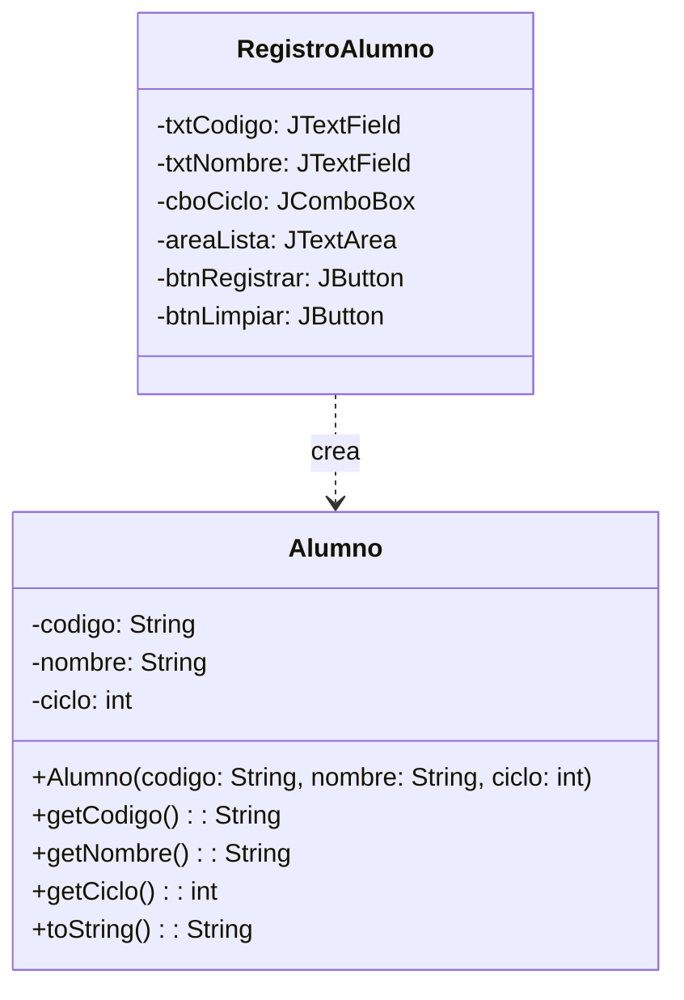
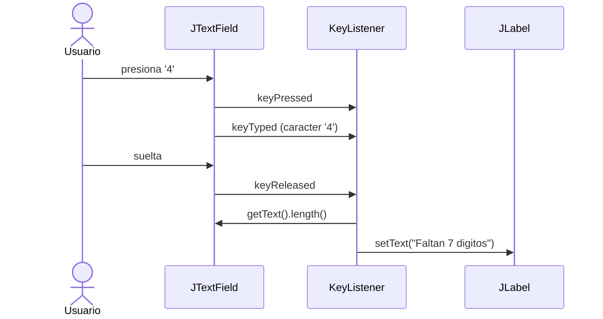
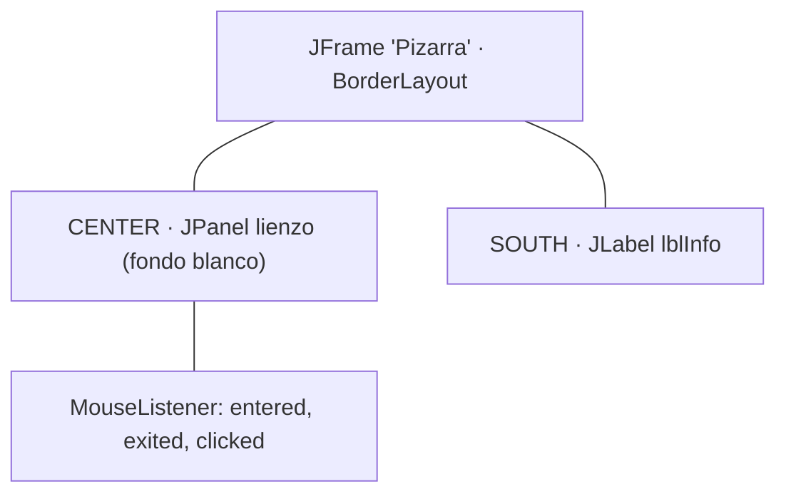
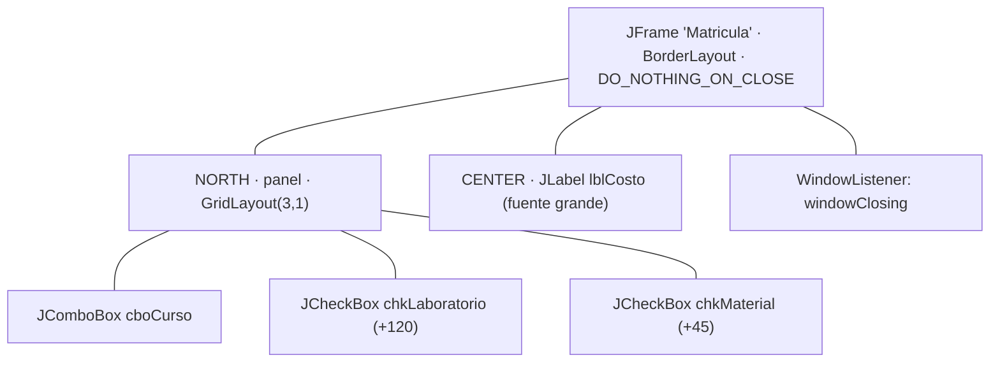

# Prácticas de clase · Semana 12

Ocho prácticas: **tres de componentes y contenedores** y **cinco de eventos**.
Cada una tiene un caso, su diagrama, los pasos a seguir y el resultado que debes obtener.

**Cómo trabajar cada práctica**

1. Lee el caso y mira el diagrama: es el **diseño completo** de la ventana que debes programar. Las flechas indican contención (quién está dentro de quién), no herencia.
2. Crea un proyecto (o una carpeta) nuevo en tu IDE.
3. Sigue los pasos en orden: primero el marco, luego los componentes, al final los eventos.
4. Ejecuta y compara tu ventana con la figura de **resultado esperado**.
5. Responde la pregunta final con tus palabras.

> **La regla que vas a repetir toda la semana:** el marco nace invisible y el layout manda. Si no ves algo, hay dos sospechosos antes que tu código: te faltó `setVisible(true)` o el gestor lo puso donde tú no mirabas.

---

# Parte 1 · El marco, los componentes y los contenedores

## Práctica 1 · `VentanaBienvenida` (el marco mínimo)

**Caso:** la facultad quiere una ventana de bienvenida que muestre un mensaje centrado. Nada más: sin botones, sin campos, sin eventos. El objetivo es que entiendas qué es lo mínimo imprescindible para que una ventana exista y se vea.



**Pasos**

1. Crea la clase `public class VentanaBienvenida extends JFrame` y agrega `import javax.swing.*;`
2. En el constructor, llama a `setTitle("Bienvenida");`
3. Agrega la etiqueta: `add(new JLabel("Bienvenido a POO I", SwingConstants.CENTER));`
4. Dale tamaño: `setSize(320, 140);`
5. Centra la ventana en la pantalla con `setLocationRelativeTo(null);` — **ojo, va después de `setSize`**, porque para centrarla Java necesita saber cuánto mide.
6. En el `main`, crea el objeto, llama a `setDefaultCloseOperation(JFrame.EXIT_ON_CLOSE)` y recién al final a `setVisible(true)`.

**Resultado esperado**

```
┌────────────────────────────────┐
│ Bienvenida                – ✕  │
│                                │
│      Bienvenido a POO I        │
│                                │
└────────────────────────────────┘
```

**Piensa:** mueve `setLocationRelativeTo(null)` a la línea **anterior** a `setSize(320, 140)` y vuelve a ejecutar. La ventana ya no queda centrada. ¿Respecto a qué tamaño se centró?

---

## Práctica 2 · `TresGestores` (el layout decide, no tú)

**Caso:** los mismos cinco botones, tres ventanas distintas. No vas a cambiar ni un componente: solo el gestor de posicionamiento. El resultado se ve tan diferente que parecen tres programas.



**Pasos**

1. Escribe un método `private static JButton[] crearBotones()` que devuelva un arreglo con cinco botones: `"Uno"`, `"Dos"`, `"Tres"`, `"Cuatro"`, `"Cinco"`. Lo vas a usar tres veces: **el mismo código de componentes para las tres ventanas**.
2. Crea `VentanaA extends JFrame`: `setLayout(new FlowLayout());` y agrega los cinco botones con un `for`.
3. Crea `VentanaB` igual, pero con `setLayout(new GridLayout(1, 5));`
4. Crea `VentanaC` igual, pero con `BorderLayout`: cada `add` lleva su región (`NORTH`, `SOUTH`, `EAST`, `WEST`, `CENTER`).
5. En el `main`, muestra las tres, cada una de 400 x 120, en posiciones distintas con `setLocation` para que no se tapen.
6. **Agranda las tres con el mouse** y observa cuál botón crece en cada una.

**Resultado esperado**

```
A (FlowLayout)   [Uno][Dos][Tres][Cuatro][Cinco]        botones del tamaño de su texto
B (GridLayout)   [ Uno ][ Dos ][Tres][Cuatro][Cinco]    las cinco celdas miden igual
C (BorderLayout) arriba Uno, abajo Dos, izquierda Cuatro,
                 derecha Tres, y Cinco ocupando todo el centro
```

**Piensa:** llena la tabla con tus palabras.

| | FlowLayout | GridLayout | BorderLayout |
|---|---|---|---|
| ¿Qué pasa al agrandar la ventana? | | | |
| ¿Todos los componentes miden igual? | | | |
| ¿Importa el orden en que haces `add`? | | | |
| ¿Cuándo lo usarías? | | | |

---

## Práctica 3 · `FichaMatricula` (paneles anidados)

**Caso:** una ficha de matrícula con tres zonas bien distintas: los datos arriba, las observaciones al medio y los botones abajo. Ningún gestor por sí solo logra eso. La solución es la del `EjemploResuelto04`: **un panel por zona**, cada uno con su propio layout.



**Pasos**

1. Crea `FichaMatricula extends JFrame` con `import javax.swing.*;` y `import java.awt.*;`
2. **Panel de datos:** `JPanel panelDatos = new JPanel(new GridLayout(4, 2, 5, 5));` y agrégale las cuatro parejas etiqueta + componente, en orden.
3. Para el ciclo usa `new JComboBox<>(new String[]{"I","II","III","IV","V","VI","VII","VIII","IX","X"});`
4. **Panel de observaciones:** un `JPanel` con `BorderLayout`, la etiqueta al `NORTH` y el `JTextArea` al `CENTER`.
5. **Panel de botones:** un `JPanel` con `FlowLayout` y los dos botones.
6. Arma el marco: `add(panelDatos, BorderLayout.NORTH); add(panelObs, BorderLayout.CENTER); add(panelBotones, BorderLayout.SOUTH);`
7. `setSize(420, 320);` y `setVisible(true);` al final. Todavía **sin eventos**: los botones no hacen nada.
8. Escribe algo largo en el área de texto, más de cinco líneas.

**Resultado esperado**

```
┌──────────────────────────────────────┐
│ Codigo:  [____________]              │
│ Alumno:  [____________]              │
│ Clave:   [••••••••••••]              │
│ Ciclo:   [ I        ▾ ]              │
├──────────────────────────────────────┤
│ Observaciones:                       │
│ ┌──────────────────────────────────┐ │
│ │                                  │ │
│ │                                  │ │
│ └──────────────────────────────────┘ │
├──────────────────────────────────────┤
│        [Guardar]  [Cancelar]         │
└──────────────────────────────────────┘
```

**Piensa:** al escribir más de cinco líneas el texto se sale y no aparece ninguna barra de desplazamiento. Un `JTextArea` **no la trae**. Envuélvelo: `panelObs.add(new JScrollPane(areaObs), BorderLayout.CENTER);` ¿Qué componente estás agregando realmente al panel ahora, el área o el scroll? ¿Y por qué eso cambia quién dibuja la barra?

---

# Parte 2 · Eventos

> **La pregunta de esta parte:** ¿en qué momento se ejecuta tu código? Hasta hoy, la respuesta era "en el orden en que lo escribiste". Desde hoy, "cuando el usuario haga algo".

## Práctica 4 · `ConversorSoles` (el primer ActionListener)

**Caso:** una ventana convierte soles a dólares con un tipo de cambio fijo de 3.75. El usuario escribe un monto, pulsa el botón, y el resultado aparece **en la ventana**, no en la consola.



**Pasos**

1. Crea `ConversorSoles extends JFrame` con `FlowLayout`. Necesitas `import java.awt.event.*;`
2. Declara como **atributos** de la clase: `private JTextField txtSoles;` `private JLabel lblResultado;` `private JButton btnConvertir;`
3. En el constructor créalos y agrégalos: la etiqueta `"Soles:"`, el campo de 10 columnas, el botón `"Convertir"` y `lblResultado` con el texto inicial `"US$ 0.00"`.
4. Declara la constante `private static final double TIPO_CAMBIO = 3.75;`
5. Registra el oyente:
   ```java
   btnConvertir.addActionListener(new ActionListener() {
       @Override
       public void actionPerformed(ActionEvent e) {
           // tu codigo aqui
       }
   });
   ```
6. Dentro de `actionPerformed`: lee `txtSoles.getText()`, conviértelo con `Double.parseDouble(...)`, divide entre `TIPO_CAMBIO` y muestra el resultado con
   `lblResultado.setText(String.format("US$ %.2f", dolares));`
7. Prueba con `100`, con `0` y con `37.5`.
8. **Ahora escribe `hola` y pulsa el botón.**

**Resultado esperado**

```
┌───────────────────────────────────────────┐
│ Soles: [100        ]  [Convertir]         │
│                                           │
│                US$ 26.67                  │
└───────────────────────────────────────────┘
```

Y al escribir `hola`, en la consola aparece una excepción y la ventana **no se cae**:

```
Exception in thread "AWT-EventQueue-0" java.lang.NumberFormatException: For input string: "hola"
```

**Piensa:** la excepción reventó, pero la ventana sigue abierta y puedes seguir pulsando el botón. Si eso hubiera pasado en el `main` de cualquier programa de las semanas anteriores, el programa habría terminado. ¿Dónde se está ejecutando entonces tu `actionPerformed`, si no es en el `main`?

> **Para arreglarlo:** envuelve el contenido de `actionPerformed` en `try { ... } catch (NumberFormatException ex) { lblResultado.setText("Monto invalido"); }`. Un error del usuario se le avisa al usuario, no a la consola.

---

## Práctica 5 · `RegistroAlumno` (el evento que construye un objeto)

**Caso:** la práctica que une las doce semanas. El formulario captura los datos, pero no los imprime sueltos: **crea un objeto `Alumno`** y lo muestra. La ventana es la cáscara; el objeto es el programa.



**Pasos**

1. **Primero la clase, no la ventana.** Crea `Alumno.java` con los tres atributos **privados**, el constructor, los `get` y un `toString()` que devuelva
   `codigo + " - " + nombre + " (ciclo " + ciclo + ")"`. Esta clase **no importa nada de Swing**: no sabe que existe una ventana.
2. Crea `RegistroAlumno extends JFrame` con la estructura de la Práctica 3: panel de datos arriba (`GridLayout(3, 2)`), `JTextArea` dentro de un `JScrollPane` al centro, panel de botones abajo.
3. El combo del ciclo lleva `"1"` a `"10"`.
4. En el `ActionListener` de `btnRegistrar`:
   - lee los tres campos;
   - **crea el objeto**: `Alumno a = new Alumno(codigo, nombre, Integer.parseInt(ciclo));`
   - agrégalo al área: `areaLista.append(a.toString() + "\n");`
   - limpia los campos de texto con `setText("")`.
5. Registra **un segundo oyente** en `btnLimpiar` que vacíe el área: `areaLista.setText("");`
6. Registra tres alumnos distintos.

**Resultado esperado**

```
┌──────────────────────────────────────────────┐
│ Codigo: [__________]                         │
│ Nombre: [__________]                         │
│ Ciclo:  [ 3      ▾ ]                         │
├──────────────────────────────────────────────┤
│ ┌──────────────────────────────────────────┐ │
│ │ U001 - Ana Soto (ciclo 3)                │ │
│ │ U002 - Luis Mena (ciclo 2)               │ │
│ │ U003 - Rosa Diaz (ciclo 5)               │ │
│ └──────────────────────────────────────────┘ │
├──────────────────────────────────────────────┤
│         [Registrar]   [Limpiar]              │
└──────────────────────────────────────────────┘
```

**Piensa:** cuentas con dos botones y **dos oyentes distintos**, cada uno con su propio `actionPerformed`. Ninguno de los dos pregunta "¿qué botón me llamó?". Compáralo con lo que habrías tenido que escribir con un solo `if (boton == btnRegistrar) ... else if ...`. ¿Dónde viste ya exactamente esa diferencia? (Pista: Semana 11, `Práctica 5`.)

> **Guarda los alumnos en un `ArrayList<Alumno>`**, además de mostrarlos en el área. Ahora el `JTextArea` es solo una forma de *ver* la lista, no la lista misma. Comprueba la diferencia: agrega un tercer botón que recorra el `ArrayList` e imprima en consola solo los alumnos de ciclo mayor a 3. Si los datos únicamente vivieran en el texto del área, ese botón sería imposible.

---

## Práctica 6 · `CampoControlado` (el teclado, tecla por tecla)

**Caso:** un campo para el DNI. Debe aceptar **solo dígitos**, avisar cuántos faltan mientras se escribe y ponerse en rojo si el usuario intenta meter una letra. Nada de esto espera a ningún botón: todo ocurre tecla por tecla.



**Pasos**

1. Crea `CampoControlado extends JFrame`. Necesitas `import java.awt.event.*;`
2. Atributos: `private JTextField txtDni;` y `private JLabel lblEstado;`
3. En el constructor, arma una ventana simple con `FlowLayout`: la etiqueta `"DNI:"`, el campo de 12 columnas y `lblEstado` con el texto `"Faltan 8 digitos"`.
4. Registra un `KeyListener` en `txtDni`. Como la interfaz tiene tres métodos, **debes escribir los tres**, aunque dos queden vacíos.
5. En `keyReleased`: calcula `int faltan = 8 - txtDni.getText().length();` y actualiza `lblEstado`. Si `faltan <= 0`, el texto es `"DNI completo"`.
6. En `keyTyped`: si el carácter **no** es un dígito, descarta la tecla con `e.consume();` y pon `lblEstado` en rojo con el mensaje `"Solo se permiten numeros"`.
   ```java
   if (!Character.isDigit(e.getKeyChar())) {
       e.consume();
       lblEstado.setForeground(Color.RED);
       lblEstado.setText("Solo se permiten numeros");
   }
   ```
7. Prueba escribiendo `4587abc1236`.

**Resultado esperado**

```
┌──────────────────────────────────────────┐
│ DNI: [45871236        ]                  │
│ DNI completo                             │
└──────────────────────────────────────────┘

Las letras simplemente no entran: el campo las ignora.
```

**Piensa:** `e.consume()` en `keyTyped` funciona; en `keyReleased` no sirve de nada. ¿Por qué? Fíjate en qué momento de la secuencia el carácter se inserta realmente en el campo, y vuelve a mirar el diagrama de arriba.

> **Reescríbelo con `KeyAdapter`.** `new KeyAdapter() { ... }` ya trae los tres métodos vacíos y te deja sobrescribir solo `keyTyped` y `keyReleased`. Cuenta las líneas que te ahorras. Esa clase existe exactamente por el problema que acabas de sufrir.

---

## Práctica 7 · `Pizarra` (el ratón y sus coordenadas)

**Caso:** un panel que reacciona al ratón: cambia de color cuando el puntero entra, vuelve a su color al salir, y lleva la cuenta de los clics informando dónde cayó cada uno.



**Pasos**

1. Crea `Pizarra extends JFrame` con atributos `private JPanel lienzo;` y `private JLabel lblInfo;` y un contador `private int clics = 0;`
2. El lienzo es un `JPanel` con `setBackground(Color.WHITE)`, al `CENTER`. `lblInfo` va al `SOUTH`.
3. Registra el oyente con **`MouseAdapter`**, no con `MouseListener`:
   ```java
   lienzo.addMouseListener(new MouseAdapter() {
       // solo los metodos que te interesan
   });
   ```
4. `mouseEntered`: fondo `Color.YELLOW`. `mouseExited`: fondo `Color.WHITE`.
5. `mouseClicked`: incrementa el contador y pon en `lblInfo`
   `"Clic #" + clics + " en (" + e.getX() + ", " + e.getY() + ")"`.
6. Haz clic en la esquina superior izquierda del panel y después en la inferior derecha. Anota las coordenadas.

**Resultado esperado**

```
┌───────────────────────────────────────┐
│                                       │  blanco  → puntero afuera
│          (panel lienzo)               │  amarillo→ puntero adentro
│                                       │
├───────────────────────────────────────┤
│ Clic #3 en (287, 154)                 │
└───────────────────────────────────────┘
```

**Piensa:** la esquina superior izquierda del panel da `(0, 0)` o algo muy cercano, **no** las coordenadas de tu pantalla. ¿Respecto a qué está midiendo `e.getX()`? Ahora registra el mismo oyente en el `JFrame` en vez del panel y haz clic en el mismo punto: los números cambian. ¿Por qué?

> **Compara con la Práctica 6.** Allá usaste `KeyListener` con tres métodos y dos vacíos; aquí usaste `MouseAdapter` y escribiste solo tres de cinco. Las dos formas son válidas. La pregunta de diseño es: ¿qué ganaste y qué perdiste al heredar de una clase en vez de implementar la interfaz? (Pista: ya no puedes heredar de ninguna otra.)

---

## Práctica 8 · `MatriculaReactiva` (selección y cierre)

**Caso:** la práctica de cierre de la semana. Una ficha donde **nada se confirma**: el costo se recalcula solo al cambiar el curso o marcar una opción. Y al intentar cerrar la ventana, el programa pregunta antes de perder los datos.



**Pasos**

1. Crea `MatriculaReactiva extends JFrame`. Atributos: el combo, las dos casillas y `lblCosto`.
2. El combo lleva tres cursos. Usa un arreglo paralelo con sus precios base:
   ```java
   String[] cursos  = {"POO I", "Estructura de Datos", "Base de Datos"};
   double[] precios = {850.0, 920.0, 780.0};
   ```
3. Escribe un método `private void recalcular()` que sume el precio del curso seleccionado (`cboCurso.getSelectedIndex()` te da la posición) más `120` si el laboratorio está marcado y `45` si el material lo está, y muestre el total en `lblCosto` con `String.format("Total: S/ %.2f", total)`.
4. Registra un `ItemListener` en el combo y en las dos casillas. Los tres llaman a `recalcular()`.
5. **En el combo, filtra:** `if (e.getStateChange() == ItemEvent.SELECTED)`. Sin ese filtro, `recalcular()` corre dos veces por cada cambio.
6. Llama a `recalcular()` una vez al final del constructor, para que el total no nazca vacío.
7. Pon `setDefaultCloseOperation(JFrame.DO_NOTHING_ON_CLOSE);` y registra un `WindowListener`. En `windowClosing`, pregunta con
   `JOptionPane.showConfirmDialog(this, "Salir sin guardar la matricula?", "Confirmar", JOptionPane.YES_NO_OPTION);`
   y llama a `System.exit(0)` solo si la respuesta es `JOptionPane.YES_OPTION`.

**Resultado esperado**

```
┌────────────────────────────────────────┐
│ [ Estructura de Datos        ▾ ]       │
│ [x] Laboratorio (+120)                 │
│ [ ] Material (+45)                     │
├────────────────────────────────────────┤
│           Total: S/ 1040.00            │
└────────────────────────────────────────┘

Al pulsar la ✕:   ┌─────────────────────────────┐
                  │ Salir sin guardar la        │
                  │ matricula?     [Si]  [No]   │
                  └─────────────────────────────┘
```

**Piensa:** quita el filtro `ItemEvent.SELECTED` del combo y agrega un `System.out.println("recalculando")` dentro de `recalcular()`. Cambia de curso una sola vez y cuenta las líneas en la consola. Ahora explica, con el diagrama del `EjemploResuelto09` delante, qué fue cada una.

> **El cierre de la semana.** Cambia `DO_NOTHING_ON_CLOSE` por `EXIT_ON_CLOSE` y vuelve a pulsar la ✕: el diálogo ya no alcanza a aparecer. Esa línea no es un detalle de configuración, es **quién toma la decisión de cerrar**: Java o tú.

> **Y lo que falta.** Responder "No" salva los datos... hasta que respondas "Sí". Ningún programa de esta semana sobrevive a su propio cierre. Eso es exactamente lo que resuelve la **Semana 13 con archivos**.
