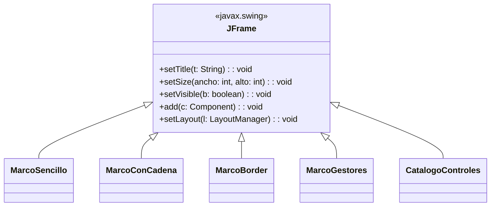
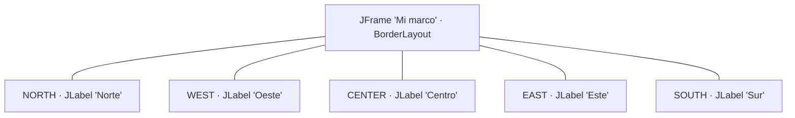
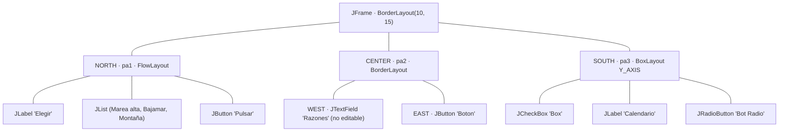
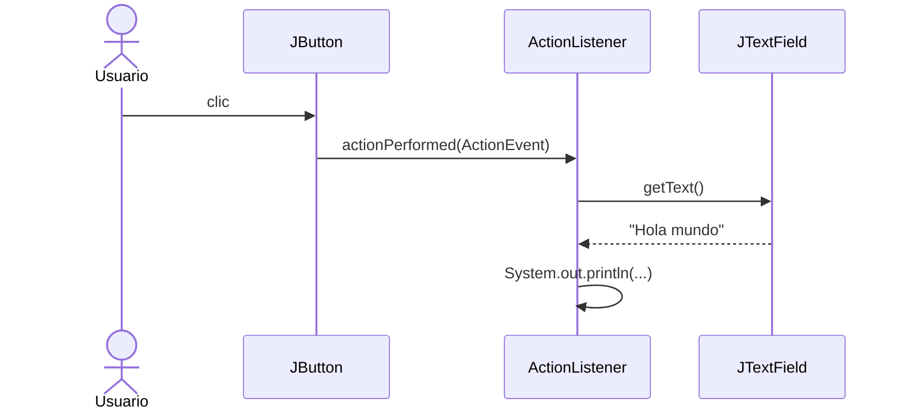
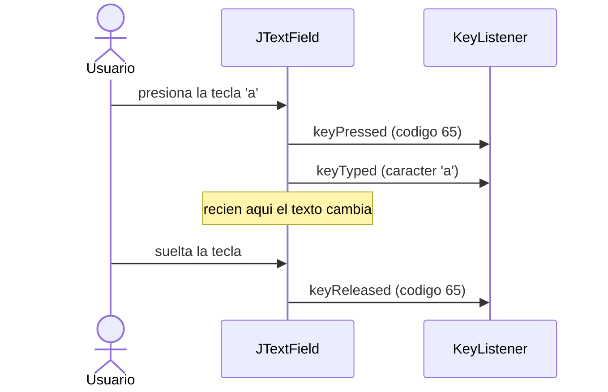
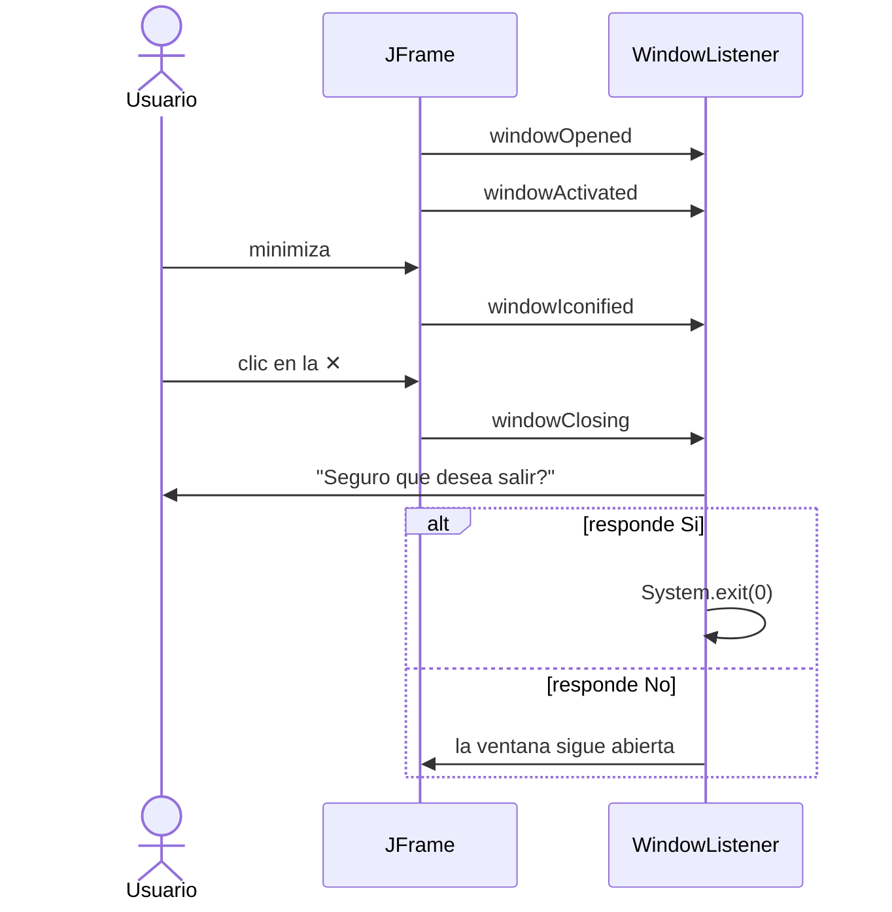
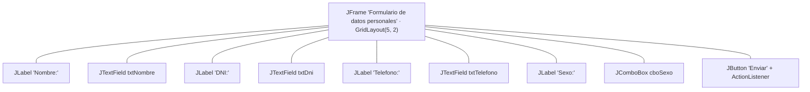
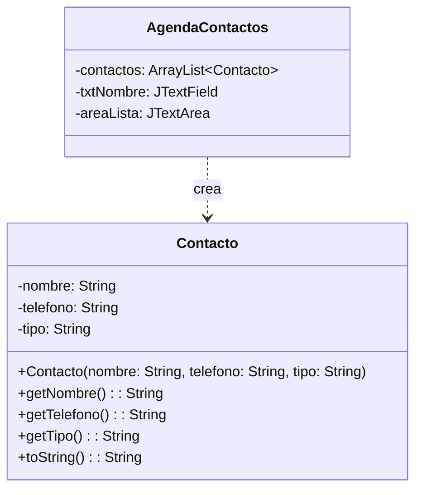

# Programación Orientada a Objetos I · Semana 12

## Interfaz gráfica de usuario: del marco al evento

Todo el código de la semana. **Cada carpeta es un proyecto independiente** y se ejecuta sola.

👉 **Prácticas paso a paso:** [`PRACTICAS_CLASE.md`](PRACTICAS_CLASE.md)

| | Qué encontrarás |
|---|---|
| `EjemploResuelto01`–`10` | Código completo y comentado línea por línea. Ábrelo, ejecútalo, modifícalo |
| `Actividad01`–`05` | Esqueletos con `TODO` para que los completes tú |

Hasta ahora tus programas terminaban solos e imprimían en consola. Esta semana cambian dos cosas: el programa **abre una ventana** y, sobre todo, deja de decidir cuándo se ejecuta tu código. Lo decide el usuario.

> En la Semana 11 viste **interfaces** y **polimorfismo**. Aquí dejan de ser teoría: `ActionListener`, `KeyListener`, `MouseListener`, `ItemListener` y `WindowListener` **son interfaces**, y cada oyente que registras es una clase que las implementa. Cuando haces clic, lo que decide qué código corre es el enlace dinámico de la semana pasada.

---

## Antes de escribir una línea

Cinco cosas que te van a ahorrar la tarde.

### 1. Crea una *Java Class*, no un *JFrame Form*

En NetBeans, *New File* ofrece dos caminos:

| Ruta en *New File* | Qué hace | ¿Esta semana? |
|---|---|---|
| *Java* → **Java Class** | Un archivo vacío que escribes tú | ✅ **Sí** |
| *Swing GUI Forms* → *JFrame Form* | Arrastras componentes y NetBeans genera el código | ❌ **No** |

> El diseñador visual genera un método `initComponents()` **bloqueado para edición**, lleno de `GroupLayout` y coordenadas automáticas. Ahí no se ve ningún `setLayout`, ningún `add` ni dónde se registra el evento: justamente lo que tienes que aprender a escribir. Es una herramienta útil, pero no todavía.

### 2. El programa no termina solo

Si olvidas `setDefaultCloseOperation(JFrame.EXIT_ON_CLOSE)`, cerrar la ventana con la ✕ **no termina el programa**. Al segundo o tercer *Run* vas a tener varias ventanas apiladas y vas a jurar que tu código no funciona.

> En la **esquina inferior derecha de NetBeans** está la barra de procesos en ejecución, con una **✕** para detener cada uno. Si algo se comporta raro, mira ahí primero.

### 3. Ejecuta el archivo, no el proyecto

Hay dieciséis carpetas y cada una tiene su propio `main`. *Run Project* (**F6**) ejecuta siempre la clase principal del proyecto, no la que tienes abierta.

> Usa **clic derecho sobre el archivo → Run File** (**Shift + F6**). Es el atajo de la semana.

### 4. Pon el proyecto en UTF-8

El primer ejemplo lleva una tilde: `setTitle("Marco vacío")`. Si el proyecto no está en UTF-8 verás `Marco vacío`.

> *Clic derecho en el proyecto → Properties → Sources → Encoding → UTF-8.*

Las clases de este repositorio **no declaran `package`**: cópialas directamente dentro de `src/` y NetBeans las mostrará bajo `<default package>`, con un aviso. Es correcto para este curso.

### 5. Si copias código de una pantalla, cuidado con las etiquetas grises

Algunos editores muestran el nombre de cada parámetro en gris claro, pegado al valor. **Esas etiquetas no son Java.** Si las copias, no compila.

```java
// Lo que se ve en algunas pantallas        // Lo que realmente se escribe
setLocation( x: ANCHO/2, y: ALTO/2);        setLocation(ANCHO/2, ALTO/2);
new JTextField( columns: 15);               new JTextField(15);
new JCheckBox( text: "Box ", selected:…);   new JCheckBox("Box ", false);
```

Los archivos de este repositorio ya están limpios.

---

## Lo que necesitas saber, en una tabla

| Lo que quieres | La llamada |
|---|---|
| Que la ventana tenga título | `setTitle("...")` o `super("...")` en el constructor |
| Darle tamaño en píxeles | `setSize(ancho, alto)` |
| Ubicarla en la pantalla | `setLocation(x, y)` · centrarla: `setLocationRelativeTo(null)` |
| Que no se pueda redimensionar | `setResizable(false)` |
| Que al cerrarla termine el programa | `setDefaultCloseOperation(JFrame.EXIT_ON_CLOSE)` |
| **Que se vea** | `setVisible(true)` |
| Elegir cómo se acomodan los componentes | `setLayout(new FlowLayout())`, `new BorderLayout()`, `new GridLayout(f, c)`, `new BoxLayout(...)` |
| Colocar un componente | `add(componente)` o `add(componente, BorderLayout.NORTH)` |
| Agrupar componentes | un `JPanel`, que a su vez tiene su propio layout |
| Dar barra de desplazamiento a un `JTextArea` | envolverlo: `new JScrollPane(area)` |
| Reaccionar a un clic | `boton.addActionListener(...)` → `actionPerformed(ActionEvent e)` |
| Reaccionar al teclado | `campo.addKeyListener(...)` → `keyPressed` / `keyTyped` / `keyReleased` |
| Reaccionar al ratón | `panel.addMouseListener(...)` → `mouseClicked`, `mouseEntered`, `mouseExited`… |
| Reaccionar a una selección | `combo.addItemListener(...)` → `itemStateChanged(ItemEvent e)` |
| Reaccionar al cierre de la ventana | `addWindowListener(...)` → `windowClosing(WindowEvent e)` |
| Leer lo que el usuario escribió | `campo.getText()` · en `JPasswordField`: `new String(campo.getPassword())` |
| Leer la opción elegida | `combo.getSelectedItem()` |

**Las tres reglas de esta semana**

1. Un marco **nace invisible**. `setVisible(true)` es, salvo que tengas una razón, la **última** línea.
2. **El gestor de posicionamiento manda.** `add()` no coloca el componente donde tú quieres, lo coloca donde el layout decide. Si el resultado te sorprende, el culpable casi siempre es el layout, no el componente.
3. **Tú no llamas al evento; el evento te llama a ti.** Tu código no pregunta "¿ya hizo clic?". Registra un objeto y se va.

---

# Parte 1 · El marco y los controles



> Todas las clases **heredan de `JFrame`**. No es decorativo: por eso puedes escribir `setTitle(...)` a secas dentro del constructor, sin ningún objeto delante. Estás llamando a un método heredado sobre `this`, igual que el `super(...)` de la Semana 10.

## EjemploResuelto01 · El marco mínimo: `MarcoSencillo`

Una ventana vacía. Lo imprescindible: **crear**, **dimensionar** y **mostrar**.

```
┌──────────────────────┐
│ Marco vacío      – ✕ │   200 x 150 px, en la posición (100, 75)
│                      │
│      (vacío)         │
│                      │
└──────────────────────┘
```

> **Compruébalo tú.** Comenta la línea `marco.setVisible(true);` y ejecuta. El programa corre, **no da error**, y no pasa absolutamente nada: el objeto existe en memoria, pero nadie lo dibujó.

> **Quita `setDefaultCloseOperation` y cierra la ventana con la ✕.** El proceso de Java sigue vivo. Cerrar la ventana y terminar el programa son dos cosas distintas.

📁 [`EjemploResuelto01`](EjemploResuelto01)

## EjemploResuelto02 · Dibujar sobre el marco: `MarcoConCadena`

El constructor recibe el título y se lo pasa a `super(c)`. Luego `paint(Graphics g)` dibuja texto y una línea directamente sobre el marco.

```
┌────────────────────────────────┐
│ Marco gráfico             – ✕  │   300 x 150, no redimensionable
│                                │
│   Bienvenido al mundo del swing│   ← Courier, negrita, 14
│   ─────────────────────────────│   ← g.drawLine
└────────────────────────────────┘
```

> **Fíjate en `super(c)`.** Es la herencia de la Semana 10: el constructor de la subclase delega en el de la superclase. `JFrame` ya tiene un constructor que recibe el título, así que no hace falta `setTitle`.

> **Tú nunca llamas a `paint()`.** Lo llama Java cada vez que necesita redibujar la ventana. Si al minimizar y restaurar ves el texto parpadear, es por eso: dibujar directamente sobre un `JFrame` funciona, pero lo recomendado en Swing es sobrescribir `paintComponent(Graphics g)` en un `JPanel` y llamar primero a `super.paintComponent(g)`. Pregúntalo en clase.

📁 [`EjemploResuelto02`](EjemploResuelto02)

## EjemploResuelto03 · El gestor por defecto: `MarcoBorder`

Cinco `JLabel` y **ninguna coordenada**. `BorderLayout` es el gestor que un `JFrame` trae de fábrica.



```
┌───────────────────────────┐
│          Norte            │  NORTH y SOUTH: todo el ancho, alto mínimo
├────────┬─────────┬────────┤
│ Oeste  │ Centro  │  Este  │  CENTER: se queda con todo lo que sobra
├────────┴─────────┴────────┤
│           Sur             │
└───────────────────────────┘
```

> **Compruébalo tú.** Cambia `add(new JLabel("Centro", ...), BorderLayout.CENTER);` por `add(new JLabel("Centro", ...));` sin la región. Compila igual y se ve igual: **la región por defecto es `CENTER`**. Ahora agrega un segundo componente también sin región y mira qué pasa con el primero.

> **Agranda la ventana con el mouse.** ¿Cuál de las cinco etiquetas crece? Esa es toda la lógica de `BorderLayout`.

📁 [`EjemploResuelto03`](EjemploResuelto03)

## EjemploResuelto04 · Paneles anidados: `MarcoGestores`

Un solo layout nunca alcanza. La solución son los **paneles**: cada `JPanel` es un contenedor con su propio gestor, y el marco acomoda los paneles, no los componentes sueltos.



**Qué se ve** — ventana de 200 x 300, no redimensionable, con los tres paneles apilados: arriba la lista y el botón en fila, al medio el campo de texto y su botón en extremos opuestos, abajo los tres controles uno sobre otro.

> **Tres gestores en una sola ventana.** `FlowLayout` pone en fila y salta de línea cuando no cabe. `BorderLayout` reparte por regiones. `BoxLayout` apila en un solo eje. La ventana es una; los gestores, tres. Solo es posible porque cada panel es un contenedor independiente.

> **`setEditable(false)` no es `setEnabled(false)`.** El primero deja ver y seleccionar pero no escribir; el segundo además lo pinta gris y lo saca del recorrido del tabulador. Pruébalos los dos.

📁 [`EjemploResuelto04`](EjemploResuelto04)

## EjemploResuelto06 · Los controles: `CatalogoControles`

Todos los controles de la semana en una ventana, cada uno junto a su nombre. **Sin eventos todavía**: aquí solo importa cómo se crea y cómo se ve cada uno.

| Control | Qué es | Dato que conviene recordar |
|---|---|---|
| `JLabel` | Texto fijo | Es **inerte**: no recibe eventos |
| `JTextField` | Una línea editable | `getText()` devuelve `String` |
| `JPasswordField` | Deriva de `JTextField`, enmascara | `getPassword()` devuelve `char[]`, **no** `String` |
| `JComboBox` | Lista desplegable | `getSelectedItem()` devuelve `Object` |
| `JButton` | Dispara acciones | El único hecho para `ActionEvent` |
| `JTextArea` | Muchas líneas | **No** trae barra: va dentro de un `JScrollPane` |
| `JCheckBox` / `JRadioButton` | Selección, no acción | Generan `ItemEvent`, no `ActionEvent` |

> **Escribe en el `JTextArea` hasta pasarte del alto visible.** La barra aparece porque el área está envuelta en un `JScrollPane`. Quítale el envoltorio (`add(area, BorderLayout.CENTER)`) y repite: el texto se sale y no hay cómo bajar. El `JScrollPane` no es un adorno, es el componente que se agrega realmente al contenedor.

> **`getPassword()` devuelve `char[]` a propósito.** Un `String` es inmutable y se queda en memoria hasta que el recolector decida; un arreglo se puede sobrescribir apenas terminas de usarlo. Es una decisión de seguridad.

📁 [`EjemploResuelto06`](EjemploResuelto06)

---

# Parte 2 · Eventos

| Carpeta | Evento | Interfaz | Se dispara cuando… |
|---|---|---|---|
| `EjemploResuelto05` | `ActionEvent` | `ActionListener` | se activa un componente (clic en un botón) |
| `EjemploResuelto07` | `KeyEvent` | `KeyListener` | hay actividad de teclado |
| `EjemploResuelto08` | `MouseEvent` | `MouseListener` | hay actividad del ratón |
| `EjemploResuelto09` | `ItemEvent` | `ItemListener` | se selecciona un elemento de una lista u opción |
| `EjemploResuelto10` | `WindowEvent` | `WindowListener` | hay actividad de la ventana |

## EjemploResuelto05 · El primer evento: `CampoTextoConBoton`

Un campo de texto, un botón, y una línea de código que **no se ejecuta cuando la escribes**, sino cuando el usuario hace clic.



**Salida en consola** (escribiendo `Hola mundo` y pulsando el botón tres veces)

```
Texto ingresado: Hola mundo
Texto ingresado: Hola mundo
Texto ingresado: Hola mundo
```

> **Lo importante es el orden.** El `main` termina casi de inmediato: crea la ventana, la muestra y se acaba. Pero el programa **no termina**. Java deja corriendo un hilo que espera eventos, y cada clic dispara tu `actionPerformed`. Por eso `EXIT_ON_CLOSE` es necesario: alguien tiene que decirle a ese hilo que pare.

> **Esa cosa rara entre paréntesis.** `new ActionListener() { ... }` es una **clase anónima**: una clase sin nombre que implementa la interfaz y se instancia en el mismo renglón. Si te cuesta leerla, escríbela aparte: crea `class MiOyente implements ActionListener` en su propio archivo y pásale `new MiOyente()` al botón. Funciona idéntico.

> **De la Semana 11 a esta.** `addActionListener(ActionListener l)` recibe el **tipo de la interfaz**, no una clase concreta. Es el mismo arreglo `Flotante[]` de la semana pasada: el botón no sabe qué clase le entregaste, solo que cumple el contrato.

📁 [`EjemploResuelto05`](EjemploResuelto05)

## EjemploResuelto07 · Teclado: `EventosDeTeclado`

Un campo, una bitácora que registra cada tecla y un contador. Cada pulsación dispara **tres** eventos, en orden.



**Bitácora** al escribir `ab`

```
keyPressed  -> codigo 65
keyTyped    -> caracter 'a'
keyReleased -> codigo 65
keyPressed  -> codigo 66
keyTyped    -> caracter 'b'
keyReleased -> codigo 66
```

> **Por qué el contador va en `keyReleased`.** Cámbialo a `keyPressed` y escribe cinco letras: el contador queda siempre **una atrás**. En `keyPressed` el carácter todavía no se insertó. El momento importa tanto como el método.

> **Pulsa Shift sola.** Se disparan `keyPressed` y `keyReleased`, pero **no** `keyTyped`: Shift no produce ningún carácter. Esa es la diferencia entre "tecla" y "carácter".

📁 [`EjemploResuelto07`](EjemploResuelto07)

## EjemploResuelto08 · Ratón: `EventosDeMouse`

Un panel que cambia de color cuando el ratón entra y sale, y que informa las coordenadas del clic.

```
┌──────────────────────────────────────┐
│                                      │   gris → el ratón está fuera
│   Pasa el raton por aqui y haz clic  │   cian → el ratón está dentro
│                                      │
├──────────────────────────────────────┤
│ mouseClicked en (143, 62) con 1 clic │
└──────────────────────────────────────┘
```

> **`e.getX()` mide respecto al componente que escucha**, no a la pantalla. Registra el mismo oyente en el marco en vez del panel, haz clic en el mismo punto y compara los números.

> **Haz doble clic rápido.** `e.getClickCount()` devuelve `2`. No existe un evento "doble clic" aparte.

> **`MouseListener` tiene cinco métodos y aquí solo se usan tres.** Los otros dos quedan vacíos porque la interfaz **obliga a implementarlos todos**. Por eso existe `MouseAdapter`: una clase que ya los trae vacíos para que sobrescribas solo el que te interesa. Reescribe este ejemplo con `new MouseAdapter() { ... }` y cuenta las líneas que te ahorras.

📁 [`EjemploResuelto08`](EjemploResuelto08)

## EjemploResuelto09 · Selección: `EventosDeSeleccion`

Un `JComboBox` y un `JCheckBox` que reportan cada cambio de estado. **No hay ningún botón**: nada se confirma, todo reacciona al instante.

**Bitácora** al cambiar de *POO I* a *Base de Datos* y marcar la casilla

```
combo  DESELECTED -> Programacion Orientada a Objetos I
combo  SELECTED   -> Base de Datos
check  marcado
```

> **Un solo cambio, dos eventos.** Elegir otra opción dispara `itemStateChanged` **dos veces**: una por la que sale y otra por la que entra. Si no filtras con `if (e.getStateChange() == ItemEvent.SELECTED)`, tu código corre el doble de veces y nunca entiendes por qué.

> **`ItemEvent` no es `ActionEvent`.** Uno dice *"el usuario quiere que hagas algo"*; el otro, *"algo cambió de estado"*. Un `JCheckBox` acepta los dos oyentes: regístrale también un `ActionListener` y observa en qué orden llegan.

📁 [`EjemploResuelto09`](EjemploResuelto09)

## EjemploResuelto10 · Ventana: `EventosDeVentana`

La ventana narra su propio ciclo de vida: abrir, activar, minimizar, restaurar, cerrar. Y al intentar cerrarla, **pregunta antes**.



> **La línea clave es `setDefaultCloseOperation(JFrame.DO_NOTHING_ON_CLOSE)`.** Con `EXIT_ON_CLOSE`, Java cierra el programa **antes** de que puedas preguntar nada. Aquí le quitas la decisión a Java para tomarla tú dentro de `windowClosing`. Cámbiala de vuelta y mira cómo el diálogo deja de servir.

> **`windowClosing` y `windowClosed` no son lo mismo.** El primero ocurre cuando el usuario *pide* cerrar y todavía se puede cancelar; el segundo, cuando ya se cerró. Todo lo que quieras hacer "antes de salir" va en `windowClosing`.

📁 [`EjemploResuelto10`](EjemploResuelto10)

---

## Actividades

| Carpeta | Caso | Qué debes hacer |
|---|---|---|
| [`Actividad01`](Actividad01) | Formulario de datos personales | `GridLayout`, cuatro entradas y un botón que imprima los datos en consola |
| [`Actividad02`](Actividad02) | Calculadora de dos operandos | `JComboBox` de operación, resultado en la ventana y manejo de errores |
| [`Actividad03`](Actividad03) | Ventana de acceso | `JPasswordField`, validación y bloqueo al tercer intento |
| [`Actividad04`](Actividad04) | Agenda de contactos | El evento **crea un objeto** y lo guarda en un `ArrayList` |
| [`Actividad05`](Actividad05) | Ficha de inscripción | `ItemListener` en combo, casillas y radios con `ButtonGroup` |

> Los esqueletos **compilan pero no hacen nada**: los constructores y los `main` están vacíos a propósito. Es lo esperado hasta que completes los `TODO`.

### Actividad01 · Formulario de datos personales



**Salida esperada en consola** al pulsar *Enviar*

```
Nombre: Ana Soto
DNI: 45871236
Telefono: 987654321
Sexo: Femenino
```

> **Por qué los componentes son atributos y no variables locales.** Si declaras `JTextField txtNombre` dentro del constructor, el `actionPerformed` no puede verlo: son dos métodos distintos. Como atributos de la clase, los ve todo el objeto.

> **Piensa en el `GridLayout(5, 2)`.** Cinco filas, dos columnas: cuatro de etiqueta + campo y una quinta para el botón. ¿Qué pasa si agregas nueve componentes en una rejilla que espera diez celdas? Pruébalo.

### Actividad02 · Calculadora

Dos campos numéricos, un `JComboBox` con `+`, `−`, `*`, `/`, y el resultado en una `JLabel`.

Lo difícil no es la cuenta, son los dos errores: que el usuario escriba `hola` donde va un número (`NumberFormatException`) y que divida entre cero. Un programa de escritorio **no puede caerse** porque el usuario escribió mal.

> **Piensa:** una división entre cero con `double` no lanza excepción, devuelve `Infinity`. ¿Lo detectaste? ¿Cómo lo avisas?

### Actividad03 · Ventana de acceso

`JPasswordField`, comparación de credenciales, contador de intentos y bloqueo del botón al tercer fallo.

> **Piensa:** `getPassword()` devuelve `char[]`. Si escribes `txtClave.getPassword().equals("usil2026")` compila y **siempre da falso**. ¿Por qué? ¿Qué estás comparando realmente? Es el mismo `equals` que redefiniste en la Semana 11.

### Actividad04 · Agenda de contactos

Dos archivos: `Contacto.java` —una clase normal, **sin un solo import de Swing**— y `AgendaContactos.java`, la ventana.



> **Esta es la actividad que une el curso entero.** La ventana captura, el objeto guarda, la lista acumula. Si `Contacto` necesitara importar algo de Swing, el diseño estaría mal.

### Actividad05 · Ficha de inscripción

Un combo, dos casillas y dos radios, todos con `ItemListener`, y un resumen que se reescribe solo. **Sin un solo botón.**

> **El detalle que casi todos fallan:** dos `JRadioButton` sueltos **no** son excluyentes, se pueden marcar los dos. Lo que los hace excluyentes es meterlos en un `ButtonGroup`. Y el `ButtonGroup` agrupa el comportamiento, **no los dibuja**: al panel se agregan los botones, no el grupo.

---

## Cómo ejecutar

Cada carpeta es independiente. Desde la terminal, parado dentro de la carpeta:

```
javac MarcoSencillo.java
java MarcoSencillo
```

En NetBeans: un proyecto por carpeta y **clic derecho sobre el archivo → Run File** (Shift + F6).

## Referencia

Joyanes, L. & Zahonero, I. (2011). *Programación en Java 6: Algoritmos y programación orientada a objetos* (1ª ed.). Mc Graw Hill.
