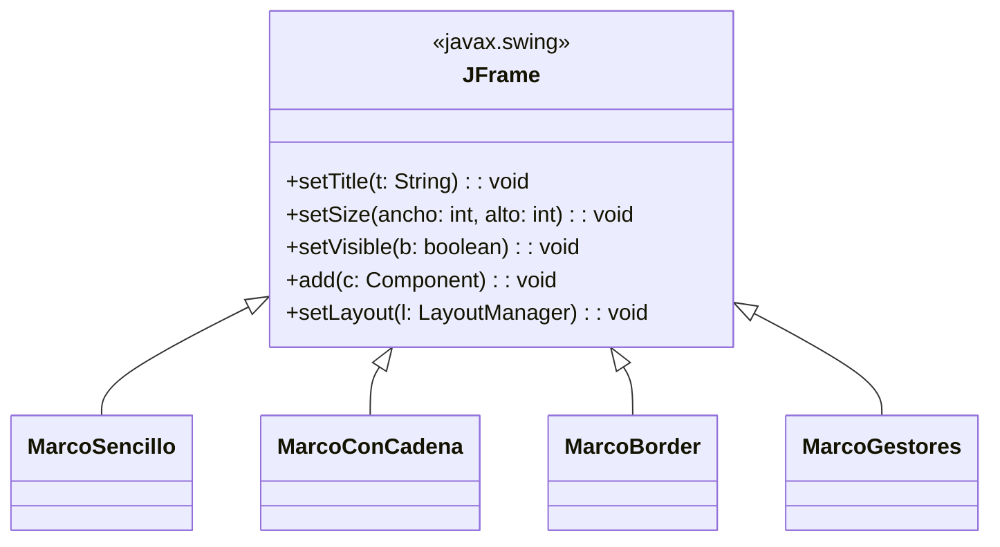
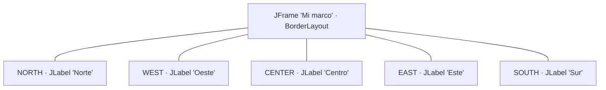
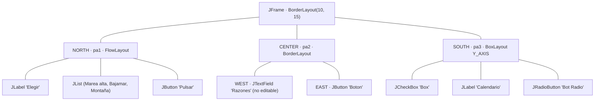
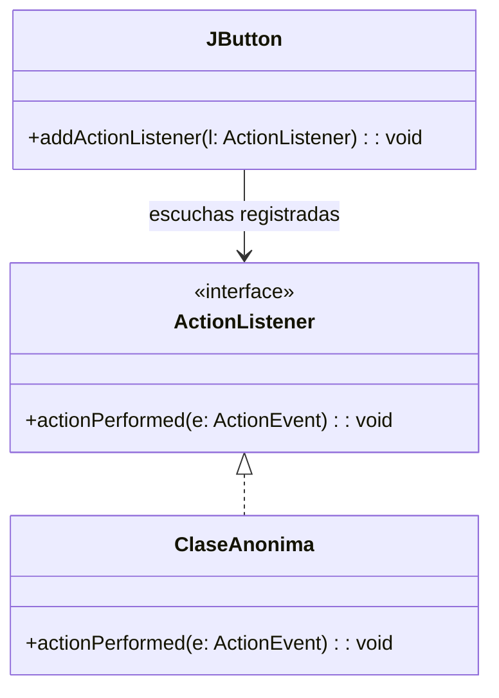
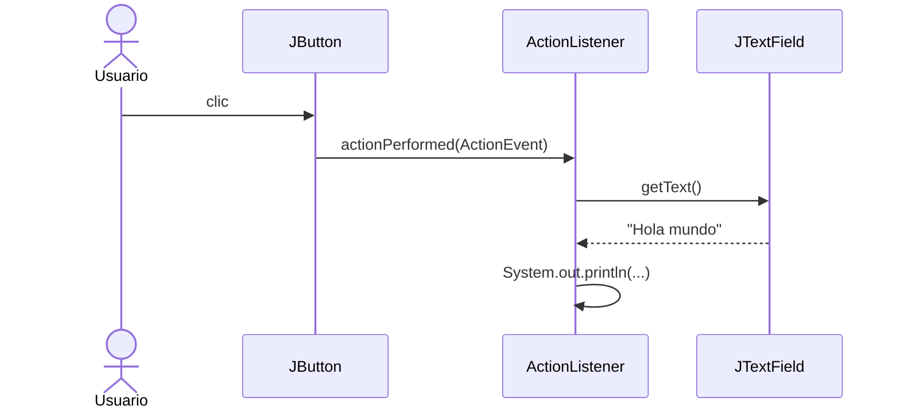
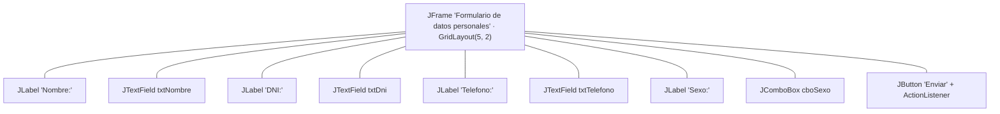

# USIL – Programación Orientada a Objetos I · Semana 12

## Interfaz Gráfica de Usuario (GUI): del marco al evento

Código que acompaña la sesión de **componentes Swing y contenedores** y de **eventos**.
Cada carpeta es un proyecto independiente y se ejecuta sola.

👉 **Prácticas de clase paso a paso:** [`PRACTICAS_CLASE.md`](PRACTICAS_CLASE.md)

### Qué se trabaja en cada bloque

| Bloque | Tema | Carpetas |
|---|---|---|
| **1** | El marco `JFrame`, los componentes y los gestores de posicionamiento | `EjemploResuelto01`–`EjemploResuelto04` |
| **2** | Eventos: `ActionListener` y la respuesta del programa | `EjemploResuelto05`, `Actividad01` |

> En la Semana 11 viste **interfaces** y **polimorfismo**. Esta semana no son teoría: `ActionListener` **es** una interfaz, y el objeto que le entregas al botón **es** una clase que la implementa. Cuando el usuario hace clic, quien decide qué código ejecutar es el enlace dinámico que estudiaste la semana pasada. La GUI es el primer lugar donde el polimorfismo deja de ser un ejercicio y pasa a ser infraestructura.

> **Dónde está cada ejemplo en el material de clase.** Las cinco clases de `EjemploResuelto01`–`EjemploResuelto05` son las que aparecen en las diapositivas 15 a 21 del deck `(12-1) MatClase-1`, transcritas **tal cual**. Lo único que se agregó son los `import` que la diapositiva recorta por falta de espacio: sin ellos el archivo no compila.

## De la diapositiva al código (resumen)

| Lo que quieres | La llamada |
|---|---|
| Que la ventana tenga título | `setTitle("...")` o `super("...")` en el constructor |
| Darle tamaño en píxeles | `setSize(ancho, alto)` |
| Ubicarla en la pantalla | `setLocation(x, y)` |
| Que el usuario no pueda redimensionarla | `setResizable(false)` |
| Que al cerrarla termine el programa | `setDefaultCloseOperation(JFrame.EXIT_ON_CLOSE)` |
| **Que se vea** | `setVisible(true)` |
| Elegir cómo se acomodan los componentes | `setLayout(new FlowLayout())`, `new BorderLayout()`, `new GridLayout(f, c)`, `new BoxLayout(...)` |
| Colocar un componente | `add(componente)` o `add(componente, BorderLayout.NORTH)` |
| Agrupar componentes | un `JPanel`, que a su vez tiene su propio layout |
| Reaccionar a un clic | `boton.addActionListener(...)` y escribir `actionPerformed(ActionEvent e)` |
| Leer lo que el usuario escribió | `campo.getText()` |
| Leer la opción elegida | `combo.getSelectedItem()` |

**Las tres reglas de esta semana**

1. Un marco **nace invisible**. `setVisible(true)` es, salvo que tengas una razón, la **última** línea: todo lo que agregues después de mostrarlo puede no aparecer hasta que la ventana se repinte.
2. **El gestor de posicionamiento manda.** `add()` no coloca el componente donde tú quieres, lo coloca donde el layout decide. Si el resultado te sorprende, el culpable casi siempre es el layout, no el componente.
3. **Tú no llamas al evento; el evento te llama a ti.** Tu código no pregunta "¿ya hizo clic?". Registra un objeto y se va. Es el mismo giro que verás en cualquier framework.

---

# Bloque 1 · El marco, los componentes y los gestores



> Las cuatro clases **heredan de `JFrame`**. No es una decisión decorativa: por eso puedes escribir `setTitle(...)` a secas dentro del constructor, sin ningún objeto delante. Estás llamando a un método heredado sobre `this`, exactamente como `super(...)` de la Semana 10.

## EjemploResuelto01 · El marco mínimo: `MarcoSencillo`

Una ventana vacía. Sirve para aislar lo imprescindible: **crear**, **dimensionar** y **mostrar**.

**Qué se ve**

```
┌──────────────────────┐
│ Marco vacío      – ✕ │   200 x 150 px, en la posición (100, 75)
│                      │
│      (vacío)         │
│                      │
└──────────────────────┘
```

> **Compruébalo tú.** Comenta la línea `marco.setVisible(true);` y ejecuta. El programa corre, **no da error**, y no pasa absolutamente nada: el objeto existe en memoria, pero nadie lo dibujó. Un `JFrame` recién creado es invisible por definición.

> **Fíjate en `setDefaultCloseOperation`.** Si lo quitas y cierras la ventana con la ✕, el proceso de Java **sigue vivo** (en NetBeans lo verás en la barra inferior). Cerrar la ventana y terminar el programa son dos cosas distintas.

📁 [`EjemploResuelto01`](EjemploResuelto01)

## EjemploResuelto02 · Dibujar sobre el marco: `MarcoConCadena`

El constructor recibe el título y se lo pasa a `super(c)`. Luego `paint(Graphics g)` dibuja texto y una línea directamente sobre el marco.

**Qué se ve**

```
┌────────────────────────────────┐
│ Marco gráfico             – ✕  │   300 x 150, no redimensionable
│                                │
│   Bienvenido al mundo del swing│   ← Courier, negrita, 14
│   ─────────────────────────────│   ← g.drawLine
└────────────────────────────────┘
```

> **Fíjate en `super(c)`.** Es la misma herencia de la Semana 10: el constructor de la subclase delega en el de la superclase. `JFrame` tiene un constructor que recibe el título, así que no hace falta llamar a `setTitle`.

> **Ojo con este ejemplo.** Sobrescribir `paint()` en un `JFrame` funciona y es lo que muestra la diapositiva, pero **no es la forma recomendada en Swing**: lo correcto es sobrescribir `paintComponent(Graphics g)` en un `JPanel` y llamar primero a `super.paintComponent(g)`. Si al redimensionar o minimizar ves el texto parpadear o desaparecer, no es un error tuyo: es exactamente por esto. Guárdalo como pregunta para la clase.

📁 [`EjemploResuelto02`](EjemploResuelto02)

## EjemploResuelto03 · El gestor por defecto: `MarcoBorder`

Cinco `JLabel` y **ninguna coordenada**. `BorderLayout` es el gestor que un `JFrame` trae de fábrica, y divide el espacio en cinco regiones.



**Qué se ve**

```
┌───────────────────────────┐
│          Norte            │  NORTH y SOUTH: todo el ancho, alto mínimo
├────────┬─────────┬────────┤
│ Oeste  │ Centro  │  Este  │  CENTER: se queda con todo lo que sobra
├────────┴─────────┴────────┤
│           Sur             │
└───────────────────────────┘
```

> **Compruébalo tú.** Cambia `add(new JLabel("Centro", ...), BorderLayout.CENTER);` por `add(new JLabel("Centro", ...));` sin la región. Compila igual y el resultado es el mismo: **la región por defecto de `BorderLayout` es `CENTER`**. Ahora agrega un segundo componente también sin región: el primero desaparece. `CENTER` solo admite uno.

> **Agranda la ventana con el mouse.** ¿Cuál de las cinco etiquetas crece? Esa es toda la lógica de `BorderLayout` en una frase.

📁 [`EjemploResuelto03`](EjemploResuelto03)

## EjemploResuelto04 · Paneles anidados: `MarcoGestores`

El caso real. Un solo layout nunca alcanza, así que se usan **paneles**: cada `JPanel` es un contenedor con su propio gestor, y el marco acomoda los paneles, no los componentes sueltos.



**Qué se ve** — ventana de 200 x 300 en la posición (20, 200), no redimensionable, con los tres paneles apilados: arriba la lista y el botón en fila, al medio el campo de texto y su botón en extremos opuestos, abajo los tres controles uno sobre otro.

> **Tres gestores en una sola ventana.** `FlowLayout` pone en fila y salta de línea cuando no cabe. `BorderLayout` reparte por regiones. `BoxLayout` apila en un solo eje (`Y_AXIS`, vertical). La ventana es una sola; los gestores, tres. Eso solo es posible porque cada panel es un contenedor independiente.

> **Fíjate en `j.setEditable(false)`.** El campo se ve, se puede seleccionar, pero no se puede escribir en él. No es lo mismo que `setEnabled(false)`, que además lo pinta gris y lo saca del recorrido con el tabulador. Pruébalos los dos.

> **Nota técnica.** `new JList(opc)` usa el tipo sin genéricos y el compilador avisa con *unchecked call*. Es lo que muestra la diapositiva y compila sin problema; la forma con genéricos sería `new JList<String>(opc)`. Buen momento para recordar por qué existen los genéricos.

📁 [`EjemploResuelto04`](EjemploResuelto04)

---

# Bloque 2 · Eventos

## EjemploResuelto05 · El primer evento: `CampoTextoConBoton`

Un campo de texto, un botón, y una línea de código que **no se ejecuta cuando la escribes**, sino cuando el usuario hace clic.



Y esto es lo que ocurre al hacer clic:



**Salida en consola** (escribiendo `Hola mundo` y pulsando el botón tres veces)

```
Texto ingresado: Hola mundo
Texto ingresado: Hola mundo
Texto ingresado: Hola mundo
```

> **Lo importante es el orden.** El `main` termina casi de inmediato: crea la ventana, la muestra y se acaba. Pero el programa **no termina**. Java deja corriendo un hilo que espera eventos, y cada clic dispara tu `actionPerformed`. Por eso `setDefaultCloseOperation(EXIT_ON_CLOSE)` es necesario: alguien tiene que decirle a ese hilo que pare.

> **Esa cosa rara entre paréntesis.** `new ActionListener() { ... }` es una **clase anónima**: una clase sin nombre que implementa la interfaz y se instancia en el mismo renglón. Si te cuesta leerla, escríbela aparte: crea `class MiOyente implements ActionListener` en su propio archivo y pásale `new MiOyente()` al botón. Funciona idéntico. La clase anónima solo evita el archivo extra cuando el oyente se usa una sola vez.

> **De la Semana 11 a esta.** `addActionListener(ActionListener l)` recibe el **tipo de la interfaz**, no una clase concreta. Es el mismo arreglo `Flotante[]` de la semana pasada: el botón no sabe ni le importa qué clase le entregaste, solo que cumple el contrato. Cuando te preguntes para qué servían las interfaces, esta es la respuesta.

📁 [`EjemploResuelto05`](EjemploResuelto05)

---

## Actividad de la semana

Es el caso del documento oficial `(12-2) Actividad-1`. Esta semana el material de clase no trae ejercicios propios: remite a Canvas, así que hay **una sola** carpeta de actividad.

| Carpeta | Origen | Caso | Qué debes hacer |
|---|---|---|---|
| [`Actividad01`](Actividad01) | Documento oficial | Formulario GUI de datos personales | Armar el marco con `GridLayout`, cuatro entradas y un botón que imprima los datos en consola |

> El esqueleto **compila pero no hace nada**: el constructor y el `main` están vacíos a propósito. Es lo esperado hasta que completes los `TODO`.

### Actividad01 · Formulario GUI



**Salida esperada en consola** (al pulsar *Enviar*)

```
Nombre: Ana Soto
DNI: 45871236
Telefono: 987654321
Sexo: Femenino
```

> **Por qué los componentes son atributos y no variables locales.** Si declaras `JTextField txtNombre` dentro del constructor, el `actionPerformed` no puede verlo: son dos métodos distintos. Como atributos de la clase, los ve todo el objeto. Es encapsulamiento de la Semana 5 resolviendo un problema de la Semana 12.

> **Piensa en el `GridLayout(5, 2)`.** Son cinco filas y dos columnas: cuatro filas de etiqueta + campo, y una quinta para el botón. ¿Qué pasa si agregas los nueve componentes en una grilla que espera diez celdas? Pruébalo antes de preguntar.

---

## Cómo ejecutar

Cada carpeta es independiente. Desde la terminal, parado dentro de la carpeta:

```
javac MarcoSencillo.java
java MarcoSencillo
```

En NetBeans, un proyecto por carpeta y la clase con `main` como clase principal.

> **Si ves caracteres raros** (`Marco vacío` en vez de `Marco vacío`): los archivos están en **UTF-8**. En NetBeans se corrige en *Propiedades del proyecto → Sources → Encoding → UTF-8*. Es el mismo problema que aparecerá en la Semana 13 con archivos, así que conviene arreglarlo ahora.

## Referencia

Joyanes, L. & Zahonero, I. (2011). *Programación en Java 6: Algoritmos y programación orientada a objetos* (1ª ed.). Mc Graw Hill.
