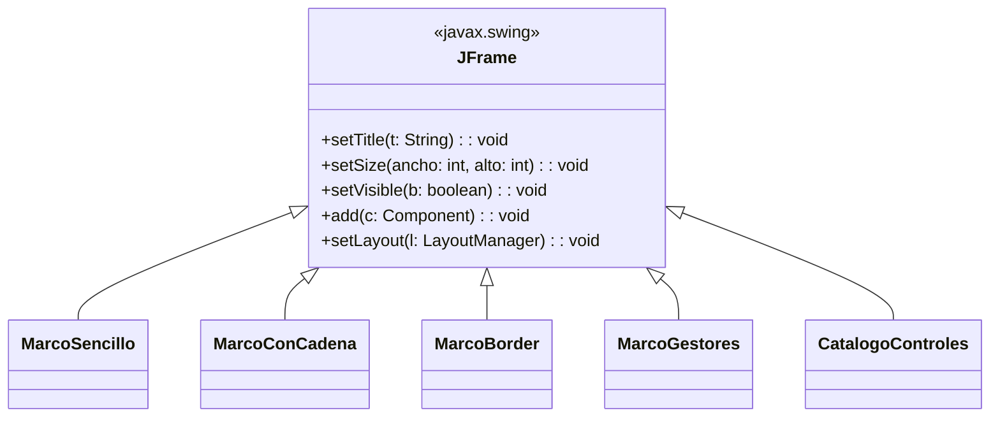
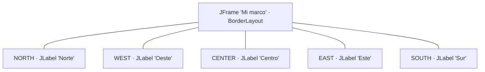
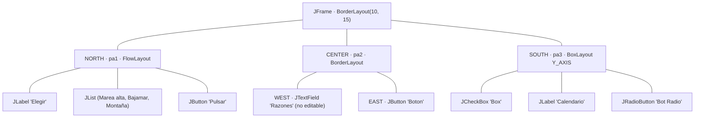
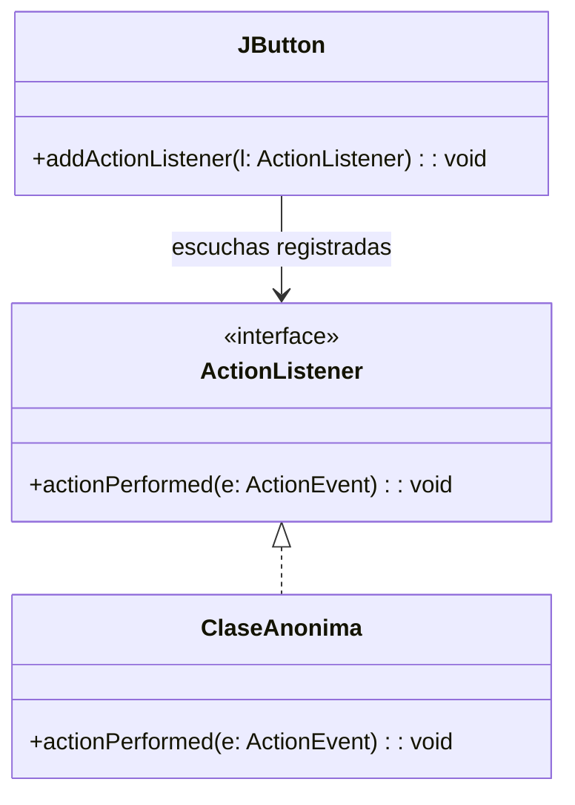
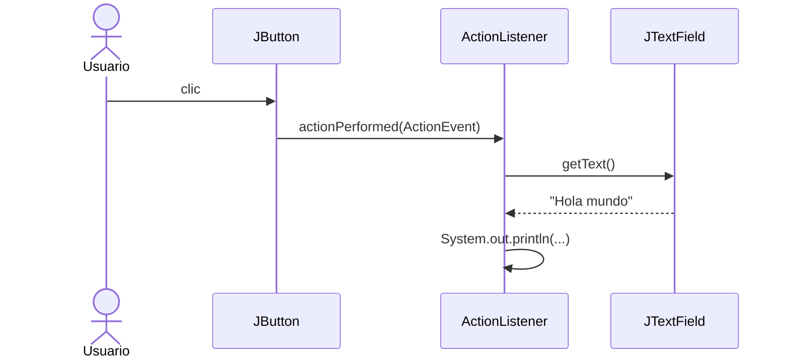
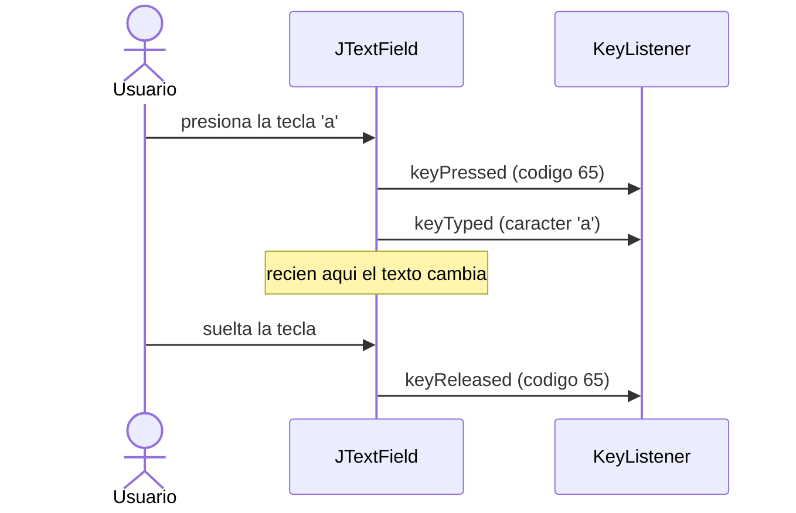
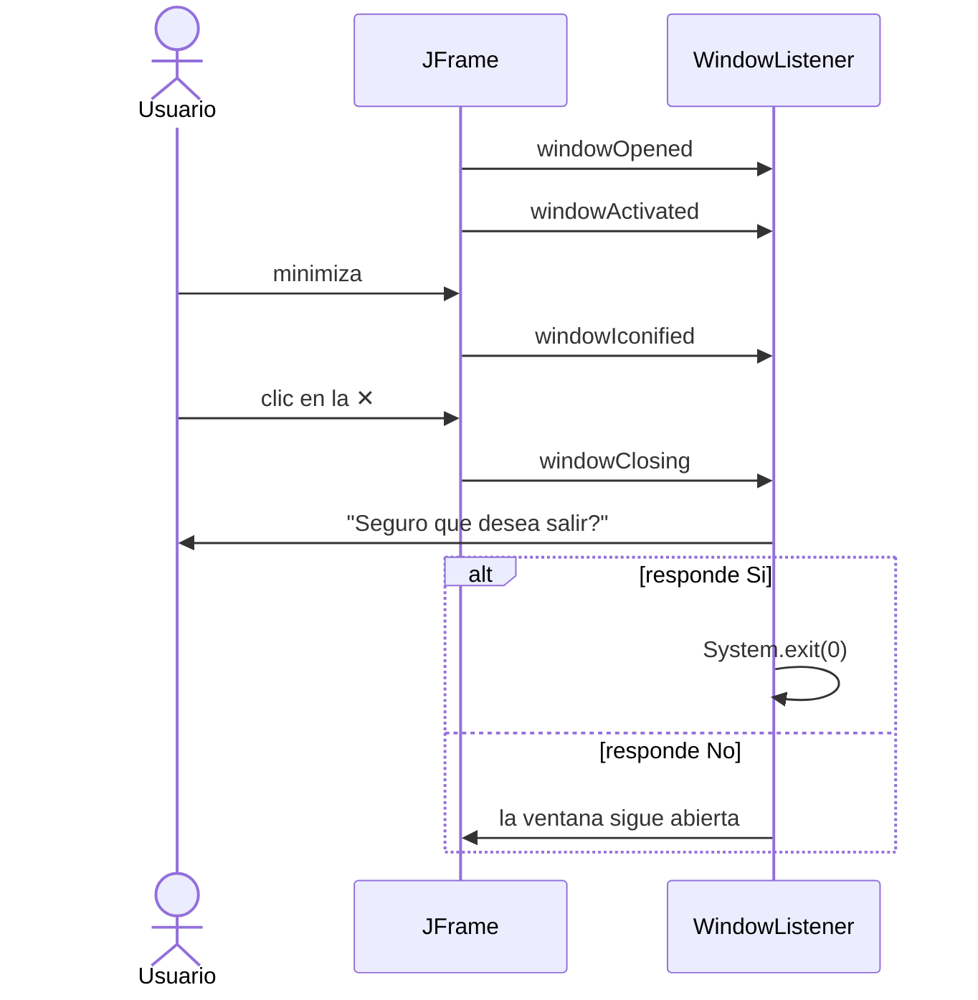
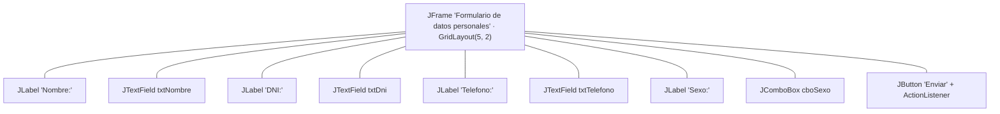
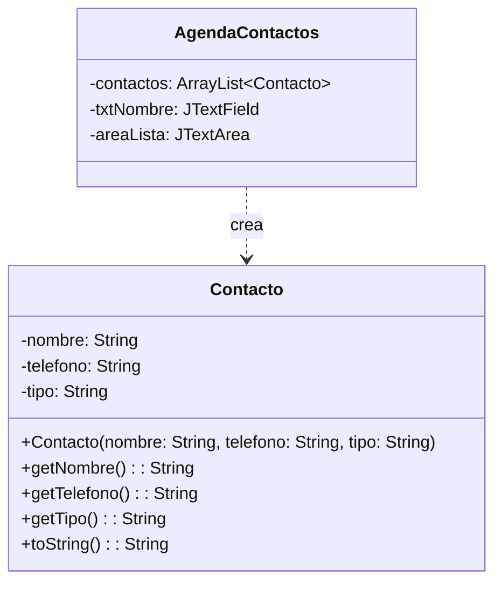

# USIL – Programación Orientada a Objetos I · Semana 12

## Interfaz Gráfica de Usuario (GUI): del marco al evento

Código que acompaña la sesión de **componentes Swing y contenedores** y de **eventos**.
Cada carpeta es un proyecto independiente y se ejecuta sola.

👉 **Prácticas de clase paso a paso:** [`PRACTICAS_CLASE.md`](PRACTICAS_CLASE.md)

> **Qué es de dónde.** `EjemploResuelto01`–`EjemploResuelto05` son las cinco clases de las diapositivas 15 a 21 del deck `(12-1) MatClase-1`, transcritas **tal cual**; lo único agregado son los `import` que la diapositiva recorta por falta de espacio. `EjemploResuelto06`–`EjemploResuelto10` **amplían** dos láminas que el material enuncia pero no ejemplifica: la lámina 13, que lista seis controles sin mostrar código de ninguno, y la lámina 20, que lista diez tipos de evento y solo ejemplifica `ActionEvent`.

## Antes de empezar · el entorno (NetBeans)

Esta semana el programa deja de terminar solo y pasa a abrir ventanas. Son **cinco cosas** que conviene dejar resueltas en los primeros minutos, porque si no se comen la clase entera.

### 1. Clase normal, NO "JFrame Form"

En NetBeans, *New File* ofrece dos caminos y **solo uno sirve para esta semana**:

| Opción | Qué hace | ¿Esta semana? |
|---|---|---|
| *Java* → **Java Class** | Un `.java` vacío que tú escribes | ✅ **Sí** |
| *Swing GUI Forms* → *JFrame Form* | Arrastras componentes y NetBeans genera el código | ❌ **No** |

> El diseñador visual genera un método `initComponents()` **bloqueado para edición**, con `GroupLayout` y coordenadas automáticas. Ese código **no se parece en nada** a las diapositivas: no hay `setLayout`, no hay `add`, no se ve dónde se registra el evento. Es una herramienta legítima y la verán más adelante, pero si la usan esta semana no aprenden qué hace cada llamada, que es justamente lo que se evalúa.

### 2. Las etiquetas grises de las diapositivas **no son código**

Las capturas del material salieron de un IDE que muestra *hints* con el nombre de cada parámetro. En la lámina se lee:

```java
setLocation( x: ANCHO/2, y: ALTO/2);
new JTextField( columns: 15);
new JLabel( text: "Norte", SwingConstants.CENTER);
```

Esos `x:`, `y:`, `columns:`, `text:` **son ayudas visuales del editor, no forman parte de Java**. En NetBeans no aparecen, y si se copian tal cual el compilador da error. Lo que se escribe es:

```java
setLocation(ANCHO/2, ALTO/2);
new JTextField(15);
new JLabel("Norte", SwingConstants.CENTER);
```

Los archivos de este repositorio ya están **sin los hints**, listos para copiar.

### 3. Ejecutar la clase correcta

Hay dieciséis carpetas y cada una tiene su propio `main`. *Run Project* (**F6**) ejecuta siempre la clase principal configurada en el proyecto, no la que tienes abierta.

> Usa **clic derecho sobre el archivo → Run File** (**Shift + F6**). Es el atajo de la semana.

### 4. Matar los procesos colgados

Si olvidas `setDefaultCloseOperation(JFrame.EXIT_ON_CLOSE)`, cerrar la ventana **no termina el programa**. Al segundo o tercer *Run* tendrás varias ventanas apiladas y vas a jurar que tu código no funciona.

> En la **esquina inferior derecha de NetBeans** aparece la barra de procesos en ejecución, con una **✕** para detener cada uno. Si algo se comporta raro, mira ahí primero.

### 5. Codificación UTF-8

El primer ejemplo del material ya trae una tilde: `setTitle("Marco vacío")`. Si el proyecto no está en UTF-8 se verá `Marco vacío`.

> *Clic derecho en el proyecto → Properties → Sources → Encoding → UTF-8.*

> **Los archivos van en el paquete por defecto.** Ninguna clase de este repositorio declara `package`, igual que en las diapositivas. Cópialos directamente dentro de `src/` y NetBeans los mostrará bajo `<default package>` con un aviso. Es correcto para este curso.

### Los primeros 20 minutos

Antes de abrir cualquier ejemplo, que **todos** lleguen a tener una ventana en pantalla:

1. Proyecto nuevo, encoding en UTF-8.
2. *New File → Java Class* llamada `VentanaBienvenida`.
3. La **Práctica 1** de [`PRACTICAS_CLASE.md`](PRACTICAS_CLASE.md): cinco líneas, sin componentes, sin eventos.
4. *Shift + F6* y ver la ventana centrada.

Recién entonces el `EjemploResuelto01`.

## Ruta de las 5 horas

| | Qué se ve | Material |
|---|---|---|
| **Sesión 1 · 3 h** | Puesta a punto del entorno (20–25 min) · el marco, los controles y los gestores | `EjemploResuelto01`–`04`, `06` · Prácticas 1 a 3 · `Actividad01` |
| **Sesión 2 · 2 h** | Eventos: el programa deja de mandar | `EjemploResuelto05`, `07`–`10` · Prácticas 4 a 8 · `Actividad02`–`05` |

> El corte no es por mitad de diapositivas: es por **quién decide cuándo se ejecuta el código**. Toda la sesión 1 es código que corre en el orden en que lo escribiste. La sesión 2 rompe eso.

### Qué se trabaja en cada bloque

| Bloque | Tema | Carpetas |
|---|---|---|
| **1** | El marco `JFrame` y los controles | `EjemploResuelto01`, `02`, `06` |
| **2** | Gestores de posicionamiento y contenedores | `EjemploResuelto03`, `04` |
| **3** | Eventos: acción, teclado, ratón, selección y ventana | `EjemploResuelto05`, `07`, `08`, `09`, `10` |

> En la Semana 11 viste **interfaces** y **polimorfismo**. Esta semana no son teoría: `ActionListener`, `KeyListener`, `MouseListener`, `ItemListener` y `WindowListener` **son interfaces**, y cada oyente que registras **es** una clase que las implementa. Cuando el usuario hace clic, quien decide qué código ejecutar es el enlace dinámico que estudiaste la semana pasada. La GUI es el primer lugar donde el polimorfismo deja de ser un ejercicio y pasa a ser infraestructura.

## De la diapositiva al código (resumen)

| Lo que quieres | La llamada |
|---|---|
| Que la ventana tenga título | `setTitle("...")` o `super("...")` en el constructor |
| Darle tamaño en píxeles | `setSize(ancho, alto)` |
| Ubicarla en la pantalla | `setLocation(x, y)` · centrarla: `setLocationRelativeTo(null)` |
| Que el usuario no pueda redimensionarla | `setResizable(false)` |
| Que al cerrarla termine el programa | `setDefaultCloseOperation(JFrame.EXIT_ON_CLOSE)` |
| **Que se vea** | `setVisible(true)` |
| Elegir cómo se acomodan los componentes | `setLayout(new FlowLayout())`, `new BorderLayout()`, `new GridLayout(f, c)`, `new BoxLayout(...)` |
| Colocar un componente | `add(componente)` o `add(componente, BorderLayout.NORTH)` |
| Agrupar componentes | un `JPanel`, que a su vez tiene su propio layout |
| Dar barra de desplazamiento a un `JTextArea` | envolverlo: `new JScrollPane(area)` |
| Reaccionar a un clic | `boton.addActionListener(...)` → `actionPerformed(ActionEvent e)` |
| Reaccionar al teclado | `campo.addKeyListener(...)` → `keyPressed` / `keyTyped` / `keyReleased` |
| Reaccionar al ratón | `panel.addMouseListener(...)` → `mouseClicked`, `mouseEntered`, `mouseExited`… |
| Reaccionar a una selección | `combo.addItemListener(...)` → `itemStateChanged(ItemEvent e)` |
| Reaccionar al cierre de la ventana | `addWindowListener(...)` → `windowClosing(WindowEvent e)` |
| Leer lo que el usuario escribió | `campo.getText()` · en `JPasswordField`: `new String(campo.getPassword())` |
| Leer la opción elegida | `combo.getSelectedItem()` |

**Las tres reglas de esta semana**

1. Un marco **nace invisible**. `setVisible(true)` es, salvo que tengas una razón, la **última** línea: todo lo que agregues después de mostrarlo puede no aparecer hasta que la ventana se repinte.
2. **El gestor de posicionamiento manda.** `add()` no coloca el componente donde tú quieres, lo coloca donde el layout decide. Si el resultado te sorprende, el culpable casi siempre es el layout, no el componente.
3. **Tú no llamas al evento; el evento te llama a ti.** Tu código no pregunta "¿ya hizo clic?". Registra un objeto y se va. Es el mismo giro que verás en cualquier framework.

---

# Bloque 1 · El marco y los controles



> Todas las clases de la semana **heredan de `JFrame`**. No es decorativo: por eso puedes escribir `setTitle(...)` a secas dentro del constructor, sin ningún objeto delante. Estás llamando a un método heredado sobre `this`, exactamente como el `super(...)` de la Semana 10.

## EjemploResuelto01 · El marco mínimo: `MarcoSencillo`

Una ventana vacía. Sirve para aislar lo imprescindible: **crear**, **dimensionar** y **mostrar**.

**Qué se ve**

```
┌──────────────────────┐
│ Marco vacío      – ✕ │   200 x 150 px, en la posición (100, 75)
│                      │
│      (vacío)         │
│                      │
└──────────────────────┘
```

> **Compruébalo tú.** Comenta la línea `marco.setVisible(true);` y ejecuta. El programa corre, **no da error**, y no pasa absolutamente nada: el objeto existe en memoria, pero nadie lo dibujó. Un `JFrame` recién creado es invisible por definición.

> **Fíjate en `setDefaultCloseOperation`.** Si lo quitas y cierras la ventana con la ✕, el proceso de Java **sigue vivo** (en NetBeans lo verás en la barra inferior). Cerrar la ventana y terminar el programa son dos cosas distintas.

📁 [`EjemploResuelto01`](EjemploResuelto01)

## EjemploResuelto02 · Dibujar sobre el marco: `MarcoConCadena`

El constructor recibe el título y se lo pasa a `super(c)`. Luego `paint(Graphics g)` dibuja texto y una línea directamente sobre el marco.

**Qué se ve**

```
┌────────────────────────────────┐
│ Marco gráfico             – ✕  │   300 x 150, no redimensionable
│                                │
│   Bienvenido al mundo del swing│   ← Courier, negrita, 14
│   ─────────────────────────────│   ← g.drawLine
└────────────────────────────────┘
```

> **Fíjate en `super(c)`.** Es la misma herencia de la Semana 10: el constructor de la subclase delega en el de la superclase. `JFrame` tiene un constructor que recibe el título, así que no hace falta llamar a `setTitle`.

> **Ojo con este ejemplo.** Sobrescribir `paint()` en un `JFrame` funciona y es lo que muestra la diapositiva, pero **no es la forma recomendada en Swing**: lo correcto es sobrescribir `paintComponent(Graphics g)` en un `JPanel` y llamar primero a `super.paintComponent(g)`. Si al redimensionar o minimizar ves el texto parpadear o desaparecer, no es un error tuyo: es exactamente por esto. Guárdalo como pregunta para la clase.

📁 [`EjemploResuelto02`](EjemploResuelto02)

## EjemploResuelto06 · Los seis controles: `CatalogoControles`

*(Amplía la lámina 13, que los lista sin mostrar código.)*

Una sola ventana con los controles del material, cada uno junto a su nombre. **Todavía sin eventos**: aquí solo importa cómo se ve y qué hace cada uno.

| Control | Qué es | Dato que conviene recordar |
|---|---|---|
| `JLabel` | Texto fijo | Es **inerte**: no recibe eventos |
| `JTextField` | Una línea editable | `getText()` devuelve `String` |
| `JPasswordField` | Deriva de `JTextField`, enmascara | `getPassword()` devuelve `char[]`, **no** `String` |
| `JComboBox` | Lista desplegable | `getSelectedItem()` devuelve `Object` |
| `JButton` | Dispara acciones | El único de la lista hecho para `ActionEvent` |
| `JTextArea` | Muchas líneas | **No** trae barra: va dentro de un `JScrollPane` |
| `JCheckBox` / `JRadioButton` | Selección, no acción | Generan `ItemEvent`, no `ActionEvent` |

> **Escribe en el `JTextArea` hasta pasarte del alto visible.** La barra de desplazamiento aparece porque el área está envuelta en un `JScrollPane`. Quítale el envoltorio (`add(area, BorderLayout.CENTER)`) y repite: el texto se sale y no hay cómo bajar. El `JScrollPane` no es un adorno, es el componente que se agrega realmente al contenedor.

> **`getPassword()` devuelve `char[]` a propósito.** Un `String` en Java es inmutable y se queda en memoria hasta que el recolector decida; un arreglo de caracteres se puede sobrescribir en cuanto terminas de usarlo. Es una decisión de seguridad, no un capricho de la API.

📁 [`EjemploResuelto06`](EjemploResuelto06)

---

# Bloque 2 · Gestores de posicionamiento y contenedores

## EjemploResuelto03 · El gestor por defecto: `MarcoBorder`

Cinco `JLabel` y **ninguna coordenada**. `BorderLayout` es el gestor que un `JFrame` trae de fábrica, y divide el espacio en cinco regiones.



**Qué se ve**

```
┌───────────────────────────┐
│          Norte            │  NORTH y SOUTH: todo el ancho, alto mínimo
├────────┬─────────┬────────┤
│ Oeste  │ Centro  │  Este  │  CENTER: se queda con todo lo que sobra
├────────┴─────────┴────────┤
│           Sur             │
└───────────────────────────┘
```

> **Compruébalo tú.** Cambia `add(new JLabel("Centro", ...), BorderLayout.CENTER);` por `add(new JLabel("Centro", ...));` sin la región. Compila igual y el resultado es el mismo: **la región por defecto de `BorderLayout` es `CENTER`**. Ahora agrega un segundo componente también sin región: el primero desaparece. `CENTER` solo admite uno.

> **Agranda la ventana con el mouse.** ¿Cuál de las cinco etiquetas crece? Esa es toda la lógica de `BorderLayout` en una frase.

📁 [`EjemploResuelto03`](EjemploResuelto03)

## EjemploResuelto04 · Paneles anidados: `MarcoGestores`

El caso real. Un solo layout nunca alcanza, así que se usan **paneles**: cada `JPanel` es un contenedor con su propio gestor, y el marco acomoda los paneles, no los componentes sueltos.



**Qué se ve** — ventana de 200 x 300 en la posición (20, 200), no redimensionable, con los tres paneles apilados: arriba la lista y el botón en fila, al medio el campo de texto y su botón en extremos opuestos, abajo los tres controles uno sobre otro.

> **Tres gestores en una sola ventana.** `FlowLayout` pone en fila y salta de línea cuando no cabe. `BorderLayout` reparte por regiones. `BoxLayout` apila en un solo eje (`Y_AXIS`, vertical). La ventana es una sola; los gestores, tres. Eso solo es posible porque cada panel es un contenedor independiente.

> **Fíjate en `j.setEditable(false)`.** El campo se ve, se puede seleccionar, pero no se puede escribir en él. No es lo mismo que `setEnabled(false)`, que además lo pinta gris y lo saca del recorrido con el tabulador. Pruébalos los dos.

> **Nota técnica.** `new JList(opc)` usa el tipo sin genéricos y el compilador avisa con *unchecked call*. Es lo que muestra la diapositiva y compila sin problema; la forma con genéricos sería `new JList<String>(opc)`. Buen momento para recordar por qué existen los genéricos.

📁 [`EjemploResuelto04`](EjemploResuelto04)

---

# Bloque 3 · Eventos

> La lámina 20 lista diez tipos de evento. Aquí hay un ejemplo ejecutable de los cinco que vas a usar de verdad este ciclo.

| Ejemplo | Evento | Interfaz | Se dispara cuando… |
|---|---|---|---|
| `EjemploResuelto05` | `ActionEvent` | `ActionListener` | se activa un componente (clic en un botón) |
| `EjemploResuelto07` | `KeyEvent` | `KeyListener` | hay actividad de teclado |
| `EjemploResuelto08` | `MouseEvent` | `MouseListener` | hay actividad del ratón |
| `EjemploResuelto09` | `ItemEvent` | `ItemListener` | se selecciona un elemento de una lista u opción |
| `EjemploResuelto10` | `WindowEvent` | `WindowListener` | hay actividad de la ventana |

## EjemploResuelto05 · El primer evento: `CampoTextoConBoton`

Un campo de texto, un botón, y una línea de código que **no se ejecuta cuando la escribes**, sino cuando el usuario hace clic.



Y esto es lo que ocurre al hacer clic:



**Salida en consola** (escribiendo `Hola mundo` y pulsando el botón tres veces)

```
Texto ingresado: Hola mundo
Texto ingresado: Hola mundo
Texto ingresado: Hola mundo
```

> **Lo importante es el orden.** El `main` termina casi de inmediato: crea la ventana, la muestra y se acaba. Pero el programa **no termina**. Java deja corriendo un hilo que espera eventos, y cada clic dispara tu `actionPerformed`. Por eso `setDefaultCloseOperation(EXIT_ON_CLOSE)` es necesario: alguien tiene que decirle a ese hilo que pare.

> **Esa cosa rara entre paréntesis.** `new ActionListener() { ... }` es una **clase anónima**: una clase sin nombre que implementa la interfaz y se instancia en el mismo renglón. Si te cuesta leerla, escríbela aparte: crea `class MiOyente implements ActionListener` en su propio archivo y pásale `new MiOyente()` al botón. Funciona idéntico. La clase anónima solo evita el archivo extra cuando el oyente se usa una sola vez.

> **De la Semana 11 a esta.** `addActionListener(ActionListener l)` recibe el **tipo de la interfaz**, no una clase concreta. Es el mismo arreglo `Flotante[]` de la semana pasada: el botón no sabe ni le importa qué clase le entregaste, solo que cumple el contrato. Cuando te preguntes para qué servían las interfaces, esta es la respuesta.

📁 [`EjemploResuelto05`](EjemploResuelto05)

## EjemploResuelto07 · Teclado: `EventosDeTeclado`

*(Amplía la lámina 20: `KeyEvent`.)*

Un campo de texto, una bitácora que registra cada tecla y un contador de caracteres. Cada pulsación dispara **tres** eventos distintos, en orden.



**Salida en la bitácora** (escribiendo `ab`)

```
keyPressed  -> codigo 65
keyTyped    -> caracter 'a'
keyReleased -> codigo 65
keyPressed  -> codigo 66
keyTyped    -> caracter 'b'
keyReleased -> codigo 66
```

> **Por qué el contador está en `keyReleased` y no en `keyPressed`.** Cámbialo a `keyPressed` y escribe cinco letras: el contador siempre va **una atrás**. En `keyPressed` el carácter todavía no se insertó en el campo. El momento importa tanto como el método.

> **Pulsa la tecla Shift sola.** Se disparan `keyPressed` y `keyReleased`, pero **no** `keyTyped`: Shift no produce ningún carácter. Esa es la diferencia entre "tecla" y "carácter".

> **Fíjate en la cabecera de la clase:** `public class EventosDeTeclado extends JFrame implements KeyListener`. Una clase hereda de **una** clase y firma **todas** las interfaces que quiera — exactamente el `extends` + `implements` del `EjemploResuelto03` de la Semana 11. Como la ventana es su propio oyente, se registra con `campo.addKeyListener(this)`.

📁 [`EjemploResuelto07`](EjemploResuelto07)

## EjemploResuelto08 · Ratón: `EventosDeMouse`

*(Amplía la lámina 20: `MouseEvent`.)*

Un panel que cambia de color cuando el ratón entra y sale, y que informa las coordenadas exactas del clic.

**Qué se ve**

```
┌──────────────────────────────────────┐
│                                      │   gris   → el ratón está fuera
│   Pasa el raton por aqui y haz clic  │   cian   → el ratón está dentro
│                                      │
├──────────────────────────────────────┤
│ mouseClicked en (143, 62) con 1 clic │
└──────────────────────────────────────┘
```

> **`MouseListener` tiene cinco métodos y aquí solo se usan tres.** Los otros dos quedan con el cuerpo vacío, porque una interfaz **obliga a implementarlos todos**. Es el precio del contrato, y es también la razón por la que Java ofrece `MouseAdapter`: una clase que ya los implementa todos vacíos para que tú sobrescribas solo el que te interesa. Reescribe este ejemplo con `new MouseAdapter() { ... }` y compara la cantidad de código.

> **Haz doble clic rápido.** `e.getClickCount()` devuelve `2`. No existe un evento "doble clic" aparte: es el mismo `mouseClicked` informando cuántos clics seguidos hubo.

📁 [`EjemploResuelto08`](EjemploResuelto08)

## EjemploResuelto09 · Selección: `EventosDeSeleccion`

*(Amplía la lámina 20: `ItemEvent`.)*

Un `JComboBox` y un `JCheckBox` que reportan cada cambio de estado. **No hay ningún botón**: nada se confirma, todo reacciona al instante.

**Salida en la bitácora** (cambiando de *POO I* a *Base de Datos* y marcando la casilla)

```
combo  DESELECTED -> Programacion Orientada a Objetos I
combo  SELECTED   -> Base de Datos
check  marcado
```

> **Un solo cambio, dos eventos.** Elegir otra opción del combo dispara `itemStateChanged` **dos veces**: una para avisar que la anterior se deseleccionó y otra para la nueva. Si no filtras con `if (e.getStateChange() == ItemEvent.SELECTED)`, tu código corre el doble de veces y nunca entiendes por qué.

> **`ItemEvent` no es `ActionEvent`.** Un `ActionEvent` dice *"el usuario quiere que hagas algo"*; un `ItemEvent` dice *"algo cambió de estado"*. Un `JCheckBox` acepta los dos oyentes. Registra también un `ActionListener` en la casilla y observa en qué orden llegan.

📁 [`EjemploResuelto09`](EjemploResuelto09)

## EjemploResuelto10 · Ventana: `EventosDeVentana`

*(Amplía la lámina 20: `WindowEvent`.)*

La ventana se registra como oyente de sí misma y narra su propio ciclo de vida: abrir, activar, minimizar, restaurar, cerrar. Y al intentar cerrarla, **pregunta antes**.



> **La línea que hace posible todo esto es `setDefaultCloseOperation(JFrame.DO_NOTHING_ON_CLOSE)`.** Con `EXIT_ON_CLOSE`, Java cierra el programa **antes** de que tú puedas preguntar nada. Aquí le quitamos la decisión a Java para tomarla nosotros dentro de `windowClosing`. Prueba a cambiarla de vuelta a `EXIT_ON_CLOSE` y mira cómo el diálogo de confirmación deja de servir para algo.

> **`windowClosing` y `windowClosed` no son lo mismo.** El primero ocurre cuando el usuario *pide* cerrar y todavía se puede cancelar; el segundo, cuando ya se cerró y no hay vuelta atrás. Todo lo que quieras hacer "antes de salir" —guardar, confirmar, avisar— va en `windowClosing`.

> **Nota:** `JOptionPane` no aparece en el material de clase. Se usa aquí porque es la forma más corta de preguntar algo al usuario; con una línea muestra un diálogo modal y devuelve la respuesta.

📁 [`EjemploResuelto10`](EjemploResuelto10)

---

## Actividades de la semana

`Actividad01` es el caso del documento oficial `(12-2) Actividad-1`. Las otras cuatro son **propuestas de clase** para cubrir las cinco horas, y usan únicamente componentes y eventos que aparecen en el material.

| Carpeta | Origen | Caso | Qué debes hacer |
|---|---|---|---|
| [`Actividad01`](Actividad01) | Documento oficial | Formulario GUI de datos personales | `GridLayout`, cuatro entradas y un botón que imprima los datos en consola |
| [`Actividad02`](Actividad02) | Propuesta de clase | Calculadora de dos operandos | `JComboBox` de operación, resultado en la ventana y manejo de errores |
| [`Actividad03`](Actividad03) | Propuesta de clase | Ventana de acceso | `JPasswordField`, validación y bloqueo al tercer intento |
| [`Actividad04`](Actividad04) | Propuesta de clase | Agenda de contactos | El evento **crea un objeto** y lo guarda en un `ArrayList` |
| [`Actividad05`](Actividad05) | Propuesta de clase | Ficha de inscripción | `ItemListener` en combo, casillas y radios con `ButtonGroup` |

> Los esqueletos **compilan pero no hacen nada**: los constructores y los `main` están vacíos a propósito. Es lo esperado hasta que completes los `TODO`.

### Actividad01 · Formulario GUI *(documento oficial)*



**Salida esperada en consola** (al pulsar *Enviar*)

```
Nombre: Ana Soto
DNI: 45871236
Telefono: 987654321
Sexo: Femenino
```

> **Por qué los componentes son atributos y no variables locales.** Si declaras `JTextField txtNombre` dentro del constructor, el `actionPerformed` no puede verlo: son dos métodos distintos. Como atributos de la clase, los ve todo el objeto. Es encapsulamiento de la Semana 5 resolviendo un problema de la Semana 12.

### Actividad02 · Calculadora simple

Dos campos numéricos, un `JComboBox` con `+`, `−`, `*`, `/`, y el resultado en una `JLabel`.

**Lo que se evalúa de verdad no es la cuenta, son los dos errores:** que el usuario escriba `hola` donde va un número (`NumberFormatException`) y que divida entre cero. Un programa de escritorio **no puede caerse** porque el usuario escribió mal.

> **Piensa:** una división entre cero con `double` no lanza excepción, devuelve `Infinity`. ¿Lo detectaste? ¿Cómo lo avisas?

### Actividad03 · Ventana de acceso

`JPasswordField`, comparación de credenciales, contador de intentos y bloqueo del botón al tercer fallo.

> **Piensa:** `getPassword()` devuelve `char[]`. Si escribes `txtClave.getPassword().equals("usil2026")` compila y **siempre da falso**. ¿Por qué? ¿Qué estás comparando realmente? (Es el mismo `equals` que redefiniste en la Actividad03 de la Semana 11.)

### Actividad04 · Agenda de contactos

Dos archivos: `Contacto.java` —una clase normal, **sin un solo import de Swing**— y `AgendaContactos.java`, la ventana.



> **Esta es la actividad que une las doce semanas.** La ventana captura; el objeto guarda; la lista acumula. Si `Contacto` necesitara importar algo de Swing, el diseño estaría mal.

> **Piensa:** al cerrar la ventana se pierden todos los contactos. Guárdalos igual en el `ArrayList`. **Eso** es exactamente lo que resuelve la Semana 13 con archivos.

### Actividad05 · Ficha de inscripción

Un combo, dos casillas y dos radios, todos con `ItemListener`, y un resumen que se reescribe solo. **Sin un solo botón.**

> **El detalle que casi todos fallan:** dos `JRadioButton` sueltos **no** son excluyentes, se pueden marcar los dos. Lo que los hace excluyentes es meterlos en un `ButtonGroup`. Y el `ButtonGroup` agrupa el comportamiento, **no los dibuja**: al panel se agregan los botones, no el grupo.

---

## Cómo ejecutar

Cada carpeta es independiente. Desde la terminal, parado dentro de la carpeta:

```
javac MarcoSencillo.java
java MarcoSencillo
```

En NetBeans, un proyecto por carpeta y la clase con `main` como clase principal.

> **Si ves caracteres raros** (`Marco vacío` en vez de `Marco vacío`): los archivos están en **UTF-8**. En NetBeans se corrige en *Propiedades del proyecto → Sources → Encoding → UTF-8*. Es el mismo problema que aparecerá en la Semana 13 con archivos, así que conviene arreglarlo ahora.

## Referencia

Joyanes, L. & Zahonero, I. (2011). *Programación en Java 6: Algoritmos y programación orientada a objetos* (1ª ed.). Mc Graw Hill.
